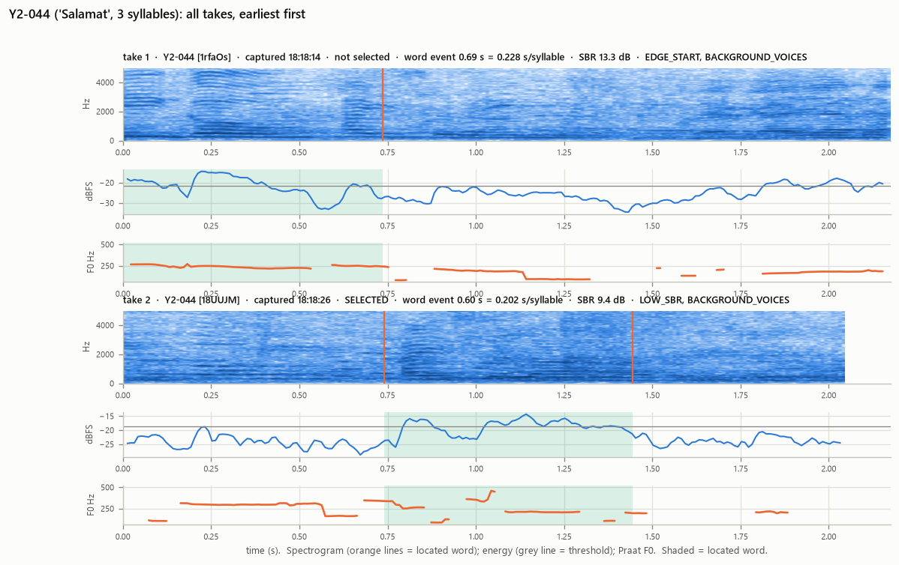
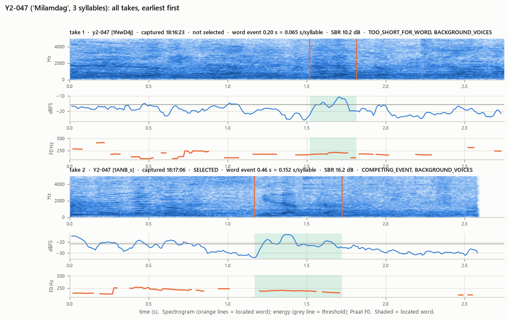
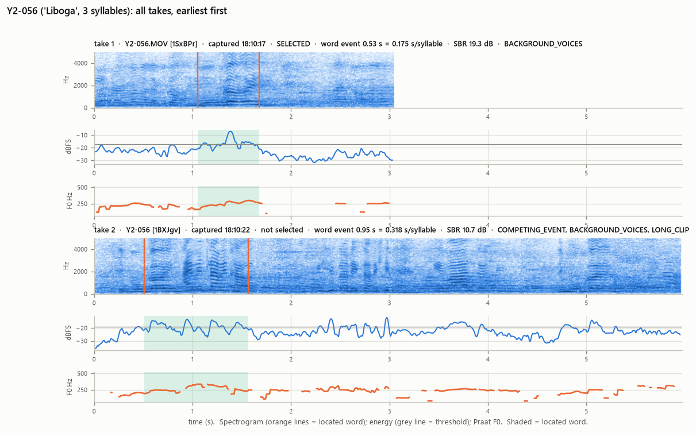
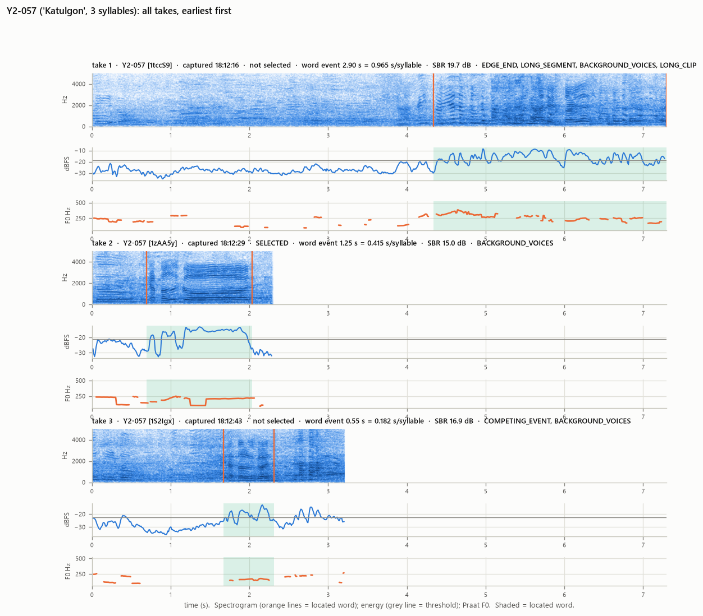
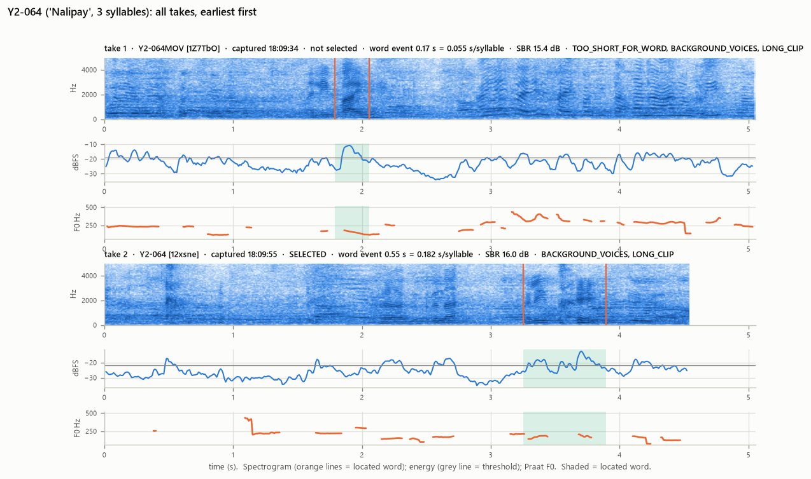

# Data Quality Report (Phases 2–5)

*Generated by `src/03_prepare_audio.py` on 2026-10-03T12:18:26+08:00. Every number is computed from the files. Per-recording detail: `reports/audio_quality_table.csv`; mapping: `data/processed_audio/file_mapping.csv`; participant inclusion: `data/analysis_manifest.csv`.*

## 1. Summary

| Quantity | Value |
|---|---|
| Total recordings (files) | 38 |
| Unique participants with recordings | 32 |
| Metadata participants | 40 |
| Missing recordings (participants) | 8: Y2-053, Y2-071, Y2-074, Y2-076, Y2-077, Y2-078, Y2-079, Y2-080 |
| Participants with duplicate recordings (retakes) | 5: Y2-044, Y2-047, Y2-056, Y2-057, Y2-064 (6 extra files) |
| Unreadable recordings | 0 |
| Recordings without detectable speech | 0 |
| Valid recordings (one selected usable take per participant) | 32 |
| Excluded recordings | 6 (non-selected retakes: 6; unusable: 0) |
| Selected recordings with ≥1 quality flag | 30 |
| Selected recordings with a segmentation-critical flag | 12 |
| **Participants included in the primary analysis** | **32** (protocol minimum: 40) |

## 2. Preprocessing (identical for every recording)

1. **Original audio QA** at native format (all files: AAC audio, 48 kHz, in MOV containers; see table). Peak, clipping (> 0.1% of samples at |x| ≥ 0.999), DC offset and level are measured before any processing.
2. **Standardisation:** `ffmpeg -i <original.mov> -map 0:a:0 -vn -ac 1 -ar 16000 -c:a pcm_s16le -map_metadata -1 -fflags +bitexact -flags:a +bitexact <name>.wav` writes the first audio stream as WAV, PCM 16-bit, mono (channel average), 16 kHz, metadata stripped. Each WAV is read back and checked to be bit-identical to the analysed samples. There is no filtering, denoising, loudness normalisation, pitch or speed change.
3. **Utterance localisation** (label-blind; `common.locate_utterance`). The clips contain continuous background babble, so the participant's word is located as the dominant short-time-energy event. Frame RMS is 25 ms/10 ms in dB, smoothed over 50 ms. The floor is the 20th percentile and the threshold is the larger of floor + 6 dB and the dB mid-point between floor and peak. Dips < 0.25 s are bridged and 0.05 s of context is added on each side. The located segment is the analysis unit for acoustic features.
4. **Speech check:** Praat autocorrelation pitch (75–500 Hz) must find ≥ 5 voiced frames inside the segment.
5. **One take per participant:** see §5.
6. **Naming:** `ParticipantCode_YearLevel_Session_Word.wav`. Session token `PM` (ASSUMPTION from the §XII example). A missing spoken word is written `UNVERIFIED` and is never inferred.

**Flag definitions.**

Segmentation-critical (excluded in the high-confidence sensitivity analysis):
- `EDGE_START` / `EDGE_END`: the event touches the clip boundary, so the word may be cut off.
- `LONG_SEGMENT`: the event is longer than 1.5 s and may contain more than one word.
- `TOO_SHORT_FOR_WORD`: the energy event lasts less than 0.1 s per syllable of the recorded word (faster than 10 syllables/s), so it cannot hold the whole word. Syllables are counted as vowel letters, which suits Cebuano spelling (y and w are glides; maayo = ma-a-yo).
- `COMPETING_EVENT`: another event lies within 3.0 dB of the peak, ≥ 0.3 s away, so the target is ambiguous.

Quality notes:
- `LOW_SBR`: the event is less than 10.0 dB above the background.
- `CLIPPING`.
- `BACKGROUND_VOICES`: ≥ 0.3 s of voicing outside the event (other speakers).
- `LONG_CLIP`: the clip is longer than 4 s.
- `CAPTURE_TIME_OUTLIER`: captured more than 60 min from the median capture time.
- `RECORDING_CONFIG_DIFFERS`: the channels or number of audio streams differ from the majority of recordings.

## 3. Per-recording quality table (all files)

| participant_code | drive_name | capture_time | orig_duration_s | orig_channels | peak_dbfs | clip_pct | sbr_db | seg_start_s | seg_end_s | voiced_frames_in_segment | flags | usable | duplicate_status | selected | standardized_filename | exclusion_reason |
|---|---|---|---|---|---|---|---|---|---|---|---|---|---|---|---|---|
| Y2-041 | Y2-041 | 2026-10-01 18:13:21 | 2.46 | mono | -8.51 | 0.0 | 9.38 | 0.83 | 1.505 | 43 | COMPETING_EVENT, LOW_SBR, BACKGROUND_VOICES | True | single | True | Y2-041_Y2_PM_Katulgon.wav | — |
| Y2-042 | Y2-042 | 2026-10-01 18:22:30 | 2.21 | mono | -8.79 | 0.0 | 15.05 | 0.55 | 0.975 | 36 | BACKGROUND_VOICES | True | single | True | Y2-042_Y2_PM_Kapoy.wav | — |
| Y2-043 | Y2-043 | 2026-10-01 18:14:03 | 1.92 | mono | -8.08 | 0.0 | 8.66 | 0.7 | 1.065 | 9 | LOW_SBR, BACKGROUND_VOICES | True | single | True | Y2-043_Y2_PM_Lipay.wav | — |
| Y2-044 | Y2-044 | 2026-10-01 18:18:14 | 2.17 | mono | -6.25 | 0.0 | 13.32 | 0.0 | 0.735 | 67 | EDGE_START, BACKGROUND_VOICES | True | RETAKE_NOT_SELECTED | False | — | retake not selected |
| Y2-044 | Y2-044 | 2026-10-01 18:18:26 | 2.04 | mono | -5.23 | 0.0 | 9.38 | 0.74 | 1.445 | 56 | LOW_SBR, BACKGROUND_VOICES | True | RETAKE_SELECTED | True | Y2-044_Y2_PM_Salamat.wav | — |
| Y2-045 | Y2-045 | 2026-10-01 18:16:00 | 2.83 | mono | -0.59 | 0.0 | 15.37 | 1.61 | 1.935 | 27 | TOO_SHORT_FOR_WORD, BACKGROUND_VOICES | True | single | True | Y2-045_Y2_PM_Maayo.wav | — |
| Y2-046 | Y2-046 | 2026-10-01 18:11:43 | 2.71 | mono | -5.84 | 0.0 | 10.31 | 0.4 | 0.815 | 24 | COMPETING_EVENT, BACKGROUND_VOICES | True | single | True | Y2-046_Y2_PM_Salamat.wav | — |
| Y2-047 | y2-047 | 2026-10-01 18:16:23 | 2.75 | mono | -2.48 | 0.0 | 10.23 | 1.52 | 1.815 | 29 | TOO_SHORT_FOR_WORD, BACKGROUND_VOICES | True | RETAKE_NOT_SELECTED | False | — | retake not selected |
| Y2-047 | Y2-047 | 2026-10-01 18:17:06 | 2.58 | mono | -6.11 | 0.0 | 16.17 | 1.17 | 1.725 | 49 | COMPETING_EVENT, BACKGROUND_VOICES | True | RETAKE_SELECTED | True | Y2-047_Y2_PM_Milamdag.wav | — |
| Y2-048 | Y2-048 | 2026-10-01 18:25:45 | 2.87 | mono | -13.12 | 0.0 | 14.9 | 0.0 | 0.805 | 74 | EDGE_START | True | single | True | Y2-048_Y2_PM_Kapoy.wav | — |
| Y2-049 | Y2-049 | 2026-10-01 18:16:13 | 2.46 | mono | -5.62 | 0.0 | 11.67 | 0.0 | 0.555 | 52 | EDGE_START, COMPETING_EVENT, BACKGROUND_VOICES | True | single | True | Y2-049_Y2_PM_Okay.wav | — |
| Y2-050 | Y2-050 | 2026-10-02 03:26:13 | 1.29 | stereo | -5.47 | 0.0 | 17.16 | 0.36 | 1.055 | 48 | CAPTURE_TIME_OUTLIER, RECORDING_CONFIG_DIFFERS | True | single | True | Y2-050_Y2_PM_Kapoy.wav | — |
| Y2-051 | Y2-051 | 2026-10-01 18:26:42 | 2.42 | mono | -12.97 | 0.0 | 10.86 | 0.02 | 1.625 | 131 | LONG_SEGMENT | True | single | True | Y2-051_Y2_PM_Gutom.wav | — |
| Y2-052 | Y2-052 | 2026-10-01 18:27:00 | 7.33 | mono | -8.03 | 0.0 | 13.62 | 2.49 | 3.365 | 70 | COMPETING_EVENT, BACKGROUND_VOICES, LONG_CLIP | True | single | True | Y2-052_Y2_PM_Kapoy.wav | — |
| Y2-054 | Y2-054 | 2026-10-01 18:19:03 | 2.0 | mono | -0.72 | 0.0 | 16.9 | 0.58 | 1.355 | 62 | BACKGROUND_VOICES | True | single | True | Y2-054_Y2_PM_Nalipay.wav | — |
| Y2-055 | Y2-055 | 2026-10-01 18:15:04 | 2.04 | mono | -3.51 | 0.0 | 11.68 | 0.68 | 0.905 | 17 | TOO_SHORT_FOR_WORD, COMPETING_EVENT, BACKGROUND_VOICES | True | single | True | Y2-055_Y2_PM_Nalingaw.wav | — |
| Y2-056 | Y2-056.MOV | 2026-10-01 18:10:17 | 3.04 | mono | -0.63 | 0.0 | 19.32 | 1.05 | 1.675 | 63 | BACKGROUND_VOICES | True | RETAKE_SELECTED | True | Y2-056_Y2_PM_Liboga.wav | — |
| Y2-056 | Y2-056 | 2026-10-01 18:10:22 | 5.96 | mono | -3.82 | 0.0 | 10.67 | 0.51 | 1.565 | 97 | COMPETING_EVENT, BACKGROUND_VOICES, LONG_CLIP | True | RETAKE_NOT_SELECTED | False | — | retake not selected |
| Y2-057 | Y2-057 | 2026-10-01 18:12:16 | 7.29 | mono | -0.65 | 0.0 | 19.68 | 4.34 | 7.295 | 208 | EDGE_END, LONG_SEGMENT, BACKGROUND_VOICES, LONG_CLIP | True | RETAKE_NOT_SELECTED | False | — | retake not selected |
| Y2-057 | Y2-057 | 2026-10-01 18:12:29 | 2.29 | mono | -5.38 | 0.0 | 15.04 | 0.69 | 2.035 | 124 | BACKGROUND_VOICES | True | RETAKE_SELECTED | True | Y2-057_Y2_PM_Katulgon.wav | — |
| Y2-057 | Y2-057 | 2026-10-01 18:12:43 | 3.21 | mono | -4.49 | 0.0 | 16.93 | 1.67 | 2.315 | 44 | COMPETING_EVENT, BACKGROUND_VOICES | True | RETAKE_NOT_SELECTED | False | — | retake not selected |
| Y2-058 | Y2-058 | 2026-10-01 18:26:28 | 1.96 | mono | -8.27 | 0.0 | 14.93 | 0.73 | 1.265 | 37 | — | True | single | True | Y2-058_Y2_PM_Kapoy.wav | — |
| Y2-059 | Y2-059 | 2026-10-01 18:38:45 | 9.46 | mono | -2.52 | 0.0 | 26.13 | 3.26 | 6.125 | 195 | LONG_SEGMENT, COMPETING_EVENT, BACKGROUND_VOICES, LONG_CLIP | True | single | True | Y2-059_Y2_PM_Kapoy.wav | — |
| Y2-060 | Y2-060 | 2026-10-01 18:13:41 | 3.04 | mono | -7.62 | 0.0 | 10.04 | 1.81 | 2.225 | 22 | BACKGROUND_VOICES | True | single | True | Y2-060_Y2_PM_Gutom.wav | — |
| Y2-061 | Y2-061 | 2026-10-01 18:20:00 | 2.75 | mono | -3.65 | 0.0 | 18.78 | 1.37 | 1.965 | 35 | BACKGROUND_VOICES | True | single | True | Y2-061_Y2_PM_Malipay.wav | — |
| Y2-062 | Y2-062 | 2026-10-01 18:19:42 | 2.25 | mono | -6.26 | 0.0 | 9.72 | 1.01 | 2.005 | 89 | COMPETING_EVENT, LOW_SBR, BACKGROUND_VOICES | True | single | True | Y2-062_Y2_PM_Nalingaw.wav | — |
| Y2-063 | Y2-063 | 2026-10-01 18:55:42 | 2.79 | stereo | -7.65 | 0.0 | 21.63 | 1.7 | 2.315 | 52 | BACKGROUND_VOICES, RECORDING_CONFIG_DIFFERS | True | single | True | Y2-063_Y2_PM_Kapoy.wav | — |
| Y2-064 | Y2-064MOV | 2026-10-01 18:09:34 | 5.04 | mono | -0.92 | 0.0 | 15.45 | 1.79 | 2.055 | 20 | TOO_SHORT_FOR_WORD, BACKGROUND_VOICES, LONG_CLIP | True | RETAKE_NOT_SELECTED | False | — | retake not selected |
| Y2-064 | Y2-064 | 2026-10-01 18:09:55 | 4.54 | mono | -3.73 | 0.0 | 15.98 | 3.25 | 3.895 | 29 | BACKGROUND_VOICES, LONG_CLIP | True | RETAKE_SELECTED | True | Y2-064_Y2_PM_Nalipay.wav | — |
| Y2-065 | Y2-065 | 2026-10-01 18:22:13 | 1.79 | mono | -1.93 | 0.0 | 19.0 | 0.64 | 1.015 | 24 | — | True | single | True | Y2-065_Y2_PM_Lingaw.wav | — |
| Y2-066 | Y2-066 | 2026-10-01 18:23:29 | 6.71 | mono | -8.67 | 0.0 | 15.94 | 0.0 | 0.825 | 71 | EDGE_START, BACKGROUND_VOICES, LONG_CLIP | True | single | True | Y2-066_Y2_PM_Salamat.wav | — |
| Y2-067 | Y2-067 | 2026-10-01 18:39:36 | 2.46 | mono | -4.57 | 0.0 | 25.94 | 1.06 | 1.725 | 56 | BACKGROUND_VOICES | True | single | True | Y2-067_Y2_PM_Kapoy.wav | — |
| Y2-068 | Y2-068.MOV | 2026-10-02 03:11:31 | 2.54 | stereo | -9.98 | 0.0 | 15.57 | 0.84 | 1.455 | 54 | BACKGROUND_VOICES, CAPTURE_TIME_OUTLIER, RECORDING_CONFIG_DIFFERS | True | single | True | Y2-068_Y2_PM_Lingaw.wav | — |
| Y2-069 | Y2-069 | 2026-10-02 03:19:07 | 2.29 | stereo | -13.4 | 0.0 | 10.5 | 0.79 | 1.665 | 68 | BACKGROUND_VOICES, CAPTURE_TIME_OUTLIER, RECORDING_CONFIG_DIFFERS | True | single | True | Y2-069_Y2_PM_Kapoy.wav | — |
| Y2-070 | Y2-070 | 2026-10-02 03:26:02 | 1.96 | stereo | -10.93 | 0.0 | 11.84 | 0.62 | 1.305 | 54 | BACKGROUND_VOICES, CAPTURE_TIME_OUTLIER, RECORDING_CONFIG_DIFFERS | True | single | True | Y2-070_Y2_PM_Kapoy.wav | — |
| Y2-072 | Y2-072.MOV | 2026-10-01 18:09:22 | 2.46 | mono | -0.86 | 0.0 | 17.89 | 1.01 | 1.515 | 35 | BACKGROUND_VOICES | True | single | True | Y2-072_Y2_PM_Nalipay.wav | — |
| Y2-073 | Y2-073 | 2026-10-01 18:14:43 | 2.38 | mono | -4.28 | 0.0 | 9.35 | 1.15 | 1.385 | 13 | LOW_SBR, BACKGROUND_VOICES | True | single | True | Y2-073_Y2_PM_UNVERIFIED.wav | — |
| Y2-075 | Y2-075 | 2026-10-02 03:22:30 | 3.33 | stereo | -7.92 | 0.0 | 13.62 | 1.67 | 2.115 | 37 | BACKGROUND_VOICES, CAPTURE_TIME_OUTLIER, RECORDING_CONFIG_DIFFERS | True | single | True | Y2-075_Y2_PM_Hangak.wav | — |

## 4. Participant-level status (all metadata participants)

| participant_code | n_takes | include_primary | exclusion_reason | selected_file | selected_flags |
|---|---|---|---|---|---|
| Y2-041 | 1 | True | — | Y2-041_Y2_PM_Katulgon.wav | COMPETING_EVENT, LOW_SBR, BACKGROUND_VOICES |
| Y2-042 | 1 | True | — | Y2-042_Y2_PM_Kapoy.wav | BACKGROUND_VOICES |
| Y2-043 | 1 | True | — | Y2-043_Y2_PM_Lipay.wav | LOW_SBR, BACKGROUND_VOICES |
| Y2-044 | 2 | True | — | Y2-044_Y2_PM_Salamat.wav | LOW_SBR, BACKGROUND_VOICES |
| Y2-045 | 1 | True | — | Y2-045_Y2_PM_Maayo.wav | TOO_SHORT_FOR_WORD, BACKGROUND_VOICES |
| Y2-046 | 1 | True | — | Y2-046_Y2_PM_Salamat.wav | COMPETING_EVENT, BACKGROUND_VOICES |
| Y2-047 | 2 | True | — | Y2-047_Y2_PM_Milamdag.wav | COMPETING_EVENT, BACKGROUND_VOICES |
| Y2-048 | 1 | True | — | Y2-048_Y2_PM_Kapoy.wav | EDGE_START |
| Y2-049 | 1 | True | — | Y2-049_Y2_PM_Okay.wav | EDGE_START, COMPETING_EVENT, BACKGROUND_VOICES |
| Y2-050 | 1 | True | — | Y2-050_Y2_PM_Kapoy.wav | CAPTURE_TIME_OUTLIER, RECORDING_CONFIG_DIFFERS |
| Y2-051 | 1 | True | — | Y2-051_Y2_PM_Gutom.wav | LONG_SEGMENT |
| Y2-052 | 1 | True | — | Y2-052_Y2_PM_Kapoy.wav | COMPETING_EVENT, BACKGROUND_VOICES, LONG_CLIP |
| Y2-053 | 0 | False | NO_RECORDING | — | — |
| Y2-054 | 1 | True | — | Y2-054_Y2_PM_Nalipay.wav | BACKGROUND_VOICES |
| Y2-055 | 1 | True | — | Y2-055_Y2_PM_Nalingaw.wav | TOO_SHORT_FOR_WORD, COMPETING_EVENT, BACKGROUND_VOICES |
| Y2-056 | 2 | True | — | Y2-056_Y2_PM_Liboga.wav | BACKGROUND_VOICES |
| Y2-057 | 3 | True | — | Y2-057_Y2_PM_Katulgon.wav | BACKGROUND_VOICES |
| Y2-058 | 1 | True | — | Y2-058_Y2_PM_Kapoy.wav | — |
| Y2-059 | 1 | True | — | Y2-059_Y2_PM_Kapoy.wav | LONG_SEGMENT, COMPETING_EVENT, BACKGROUND_VOICES, LONG_CLIP |
| Y2-060 | 1 | True | — | Y2-060_Y2_PM_Gutom.wav | BACKGROUND_VOICES |
| Y2-061 | 1 | True | — | Y2-061_Y2_PM_Malipay.wav | BACKGROUND_VOICES |
| Y2-062 | 1 | True | — | Y2-062_Y2_PM_Nalingaw.wav | COMPETING_EVENT, LOW_SBR, BACKGROUND_VOICES |
| Y2-063 | 1 | True | — | Y2-063_Y2_PM_Kapoy.wav | BACKGROUND_VOICES, RECORDING_CONFIG_DIFFERS |
| Y2-064 | 2 | True | — | Y2-064_Y2_PM_Nalipay.wav | BACKGROUND_VOICES, LONG_CLIP |
| Y2-065 | 1 | True | — | Y2-065_Y2_PM_Lingaw.wav | — |
| Y2-066 | 1 | True | — | Y2-066_Y2_PM_Salamat.wav | EDGE_START, BACKGROUND_VOICES, LONG_CLIP |
| Y2-067 | 1 | True | — | Y2-067_Y2_PM_Kapoy.wav | BACKGROUND_VOICES |
| Y2-068 | 1 | True | — | Y2-068_Y2_PM_Lingaw.wav | BACKGROUND_VOICES, CAPTURE_TIME_OUTLIER, RECORDING_CONFIG_DIFFERS |
| Y2-069 | 1 | True | — | Y2-069_Y2_PM_Kapoy.wav | BACKGROUND_VOICES, CAPTURE_TIME_OUTLIER, RECORDING_CONFIG_DIFFERS |
| Y2-070 | 1 | True | — | Y2-070_Y2_PM_Kapoy.wav | BACKGROUND_VOICES, CAPTURE_TIME_OUTLIER, RECORDING_CONFIG_DIFFERS |
| Y2-071 | 0 | False | NO_RECORDING | — | — |
| Y2-072 | 1 | True | — | Y2-072_Y2_PM_Nalipay.wav | BACKGROUND_VOICES |
| Y2-073 | 1 | True | — | Y2-073_Y2_PM_UNVERIFIED.wav | LOW_SBR, BACKGROUND_VOICES |
| Y2-074 | 0 | False | NO_RECORDING | — | — |
| Y2-075 | 1 | True | — | Y2-075_Y2_PM_Hangak.wav | BACKGROUND_VOICES, CAPTURE_TIME_OUTLIER, RECORDING_CONFIG_DIFFERS |
| Y2-076 | 0 | False | NO_RECORDING | — | — |
| Y2-077 | 0 | False | NO_RECORDING | — | — |
| Y2-078 | 0 | False | NO_RECORDING | — | — |
| Y2-079 | 0 | False | NO_RECORDING | — | — |
| Y2-080 | 0 | False | NO_RECORDING | — | — |

## 5. Duplicate (retake) resolution

The 5 duplicate sets are separate recordings, not copies. They have different content and SHA-256, and embedded capture times seconds apart on the same device, so they are retakes.

**Complete-word rule** (label-blind; the affect ratings are never consulted):
1. Drop takes whose located word is cut off by the clip edge, too long to be one word, or too short to contain the recorded word (< 0.1 s per syllable).
2. Prefer a take without a competing event of similar loudness.
3. The clearest take replaces the earliest only if it is ≥ 3 dB clearer (signal-to-background); otherwise the earliest is kept, because §X puts the natural first response first.

A take is **never** chosen for sounding more emotional: that would let the label steer the data. All takes stay untouched in `data/raw/`.

**Listening confirmation:** every take is in `data/processed_audio/retake_review/` (whole clip + located word) with `retake_review_sheet.csv` and instructions. A choice made by listening goes into `take_overrides.csv` and replaces the rule. A sensitivity analysis excludes these participants entirely.

| participant_code | drive_name | drive_file_id | capture_time | word | word_syllables | event_duration_s | event_s_per_syllable | sbr_db | flags | selected | selection_reason |
|---|---|---|---|---|---|---|---|---|---|---|---|
| Y2-044 | Y2-044 | 1rfaOs-5 | 18:18:14 | Salamat | 3.0 | 0.685 | 0.228 | 13.32 | EDGE_START;BACKGROUND_VOICES | False | — |
| Y2-044 | Y2-044 | 18UUJM0u | 18:18:26 | Salamat | 3.0 | 0.605 | 0.202 | 9.38 | LOW_SBR;BACKGROUND_VOICES | True | retake (2 takes), complete-word rule: 1 of 2 takes hold a complete word; only one take remains |
| Y2-047 | y2-047 | 1NwD4jRn | 18:16:23 | Milamdag | 3.0 | 0.195 | 0.065 | 10.23 | TOO_SHORT_FOR_WORD;BACKGROUND_VOICES | False | — |
| Y2-047 | Y2-047 | 1ANB_sY3 | 18:17:06 | Milamdag | 3.0 | 0.455 | 0.152 | 16.17 | COMPETING_EVENT;BACKGROUND_VOICES | True | retake (2 takes), complete-word rule: 1 of 2 takes hold a complete word; only one take remains |
| Y2-056 | Y2-056.MOV | 1SxBPrms | 18:10:17 | Liboga | 3.0 | 0.525 | 0.175 | 19.32 | BACKGROUND_VOICES | True | retake (2 takes), complete-word rule: 2 of 2 takes hold a complete word; 1 with a competing event dropped; only one take remains |
| Y2-056 | Y2-056 | 1BXJgv8W | 18:10:22 | Liboga | 3.0 | 0.955 | 0.318 | 10.67 | COMPETING_EVENT;BACKGROUND_VOICES;LONG_CLIP | False | — |
| Y2-057 | Y2-057 | 1tccS9z- | 18:12:16 | Katulgon | 3.0 | 2.895 | 0.965 | 19.68 | EDGE_END;LONG_SEGMENT;BACKGROUND_VOICES;LONG_CLIP | False | — |
| Y2-057 | Y2-057 | 1zAA5yeZ | 18:12:29 | Katulgon | 3.0 | 1.245 | 0.415 | 15.04 | BACKGROUND_VOICES | True | retake (3 takes), complete-word rule: 2 of 3 takes hold a complete word; 1 with a competing event dropped; only one take remains |
| Y2-057 | Y2-057 | 1S2IgxfH | 18:12:43 | Katulgon | 3.0 | 0.545 | 0.182 | 16.93 | COMPETING_EVENT;BACKGROUND_VOICES | False | — |
| Y2-064 | Y2-064MOV | 1Z7TbObk | 18:09:34 | Nalipay | 3.0 | 0.165 | 0.055 | 15.45 | TOO_SHORT_FOR_WORD;BACKGROUND_VOICES;LONG_CLIP | False | — |
| Y2-064 | Y2-064 | 12xsne3N | 18:09:55 | Nalipay | 3.0 | 0.545 | 0.182 | 15.98 | BACKGROUND_VOICES;LONG_CLIP | True | retake (2 takes), complete-word rule: 1 of 2 takes hold a complete word; only one take remains |

## 6. Recording-configuration and timing anomalies

Majority configuration: mono, 1 audio stream(s). Median capture time: 2026-10-01T18:18:26+08:00.

| participant_code | drive_name | capture_time | orig_channels | orig_audio_streams | flags |
|---|---|---|---|---|---|
| Y2-050 | Y2-050 | 2026-10-02T03:26:13+0800 | stereo | 2 | CAPTURE_TIME_OUTLIER;RECORDING_CONFIG_DIFFERS |
| Y2-063 | Y2-063 | 2026-10-01T18:55:42+0800 | stereo | 2 | BACKGROUND_VOICES;RECORDING_CONFIG_DIFFERS |
| Y2-068 | Y2-068.MOV | 2026-10-02T03:11:31+0800 | stereo | 2 | BACKGROUND_VOICES;CAPTURE_TIME_OUTLIER;RECORDING_CONFIG_DIFFERS |
| Y2-069 | Y2-069 | 2026-10-02T03:19:07+0800 | stereo | 2 | BACKGROUND_VOICES;CAPTURE_TIME_OUTLIER;RECORDING_CONFIG_DIFFERS |
| Y2-070 | Y2-070 | 2026-10-02T03:26:02+0800 | stereo | 2 | BACKGROUND_VOICES;CAPTURE_TIME_OUTLIER;RECORDING_CONFIG_DIFFERS |
| Y2-075 | Y2-075 | 2026-10-02T03:22:30+0800 | stereo | 2 | BACKGROUND_VOICES;CAPTURE_TIME_OUTLIER;RECORDING_CONFIG_DIFFERS |

Files captured about 9 hours after the session, in a different audio configuration (stereo plus a second audio track), may be later re-recordings or re-exports. The group must state how and when they were recorded. If these were not collected immediately after the class (§VII), they violate the protocol. The primary analysis keeps them, because the metadata records them as post-class observations; a sensitivity analysis excludes them.

## 7. Segmentation review (human verification needed)

The utterance location is automatic; nobody has listened to verify it. For each selected recording, a Bisaya-speaking member should listen to `data/processed_audio/segments/<name>.wav` and fill `data/processed_audio/segment_review_sheet.csv` (heard word, boundaries OK, corrected times). Corrected boundaries go into `segment_overrides.csv` and are used automatically on the next run.

