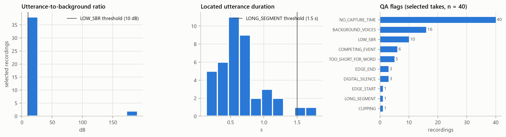
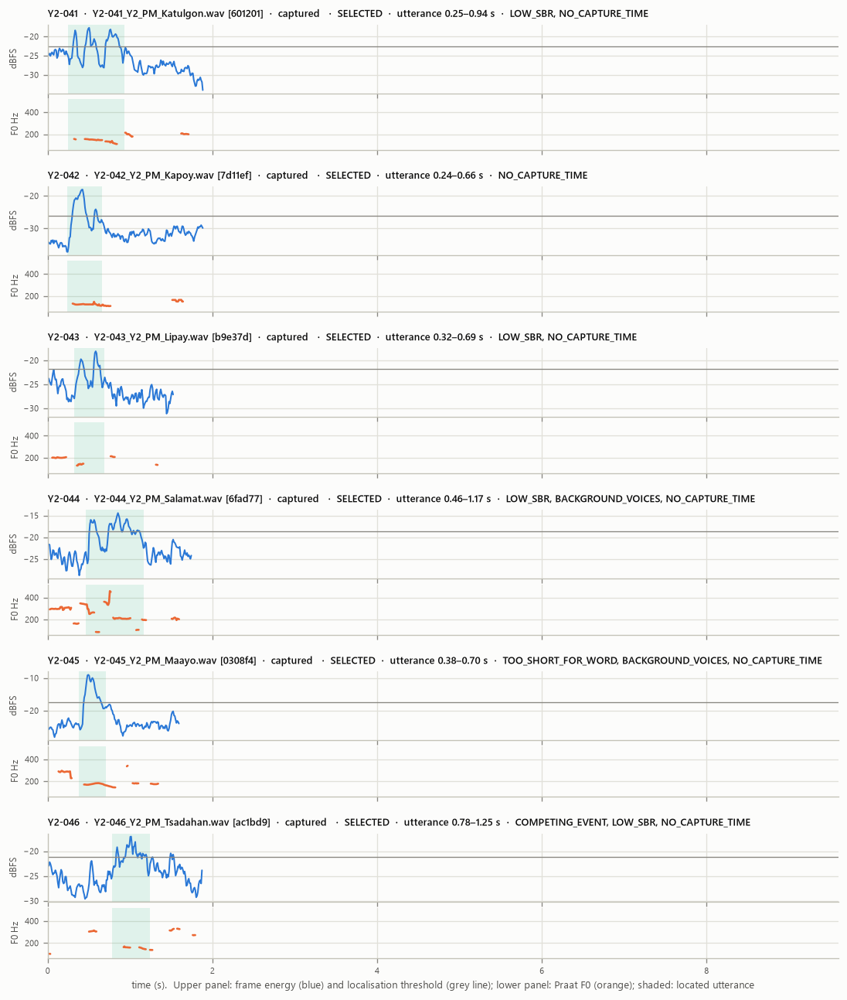
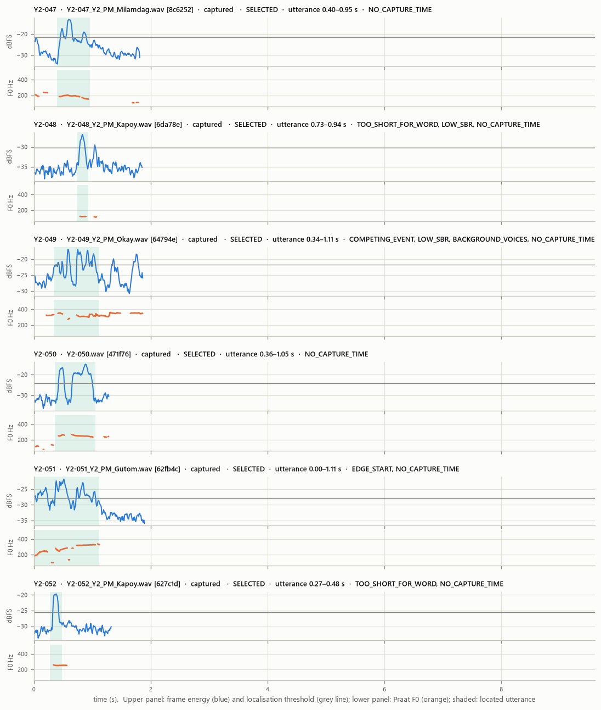
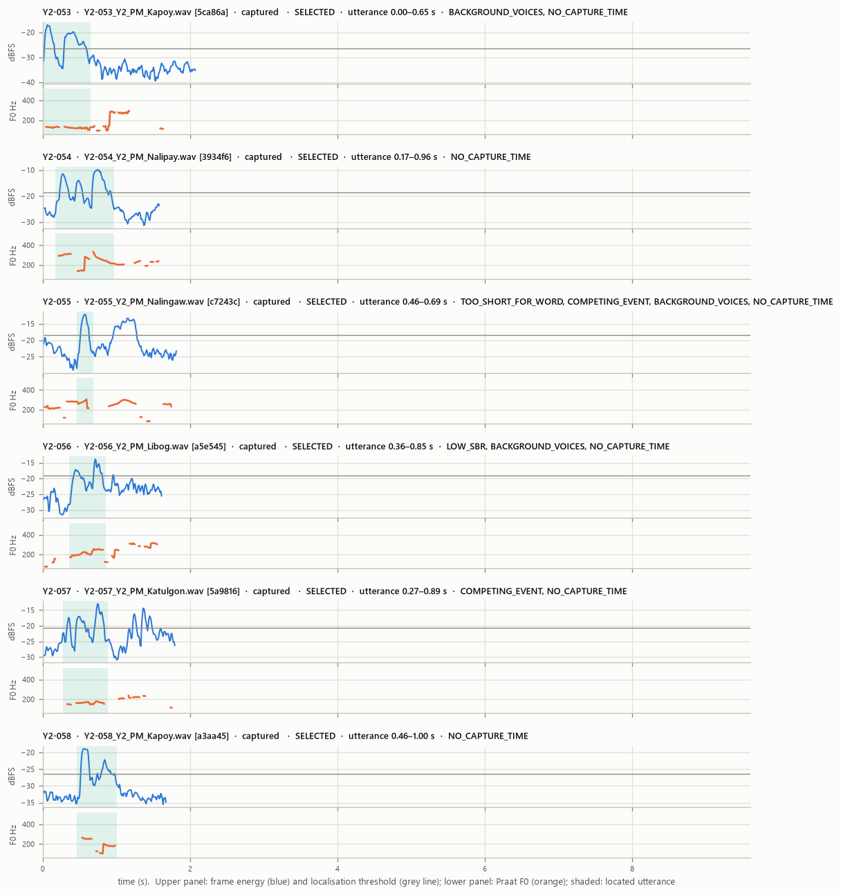
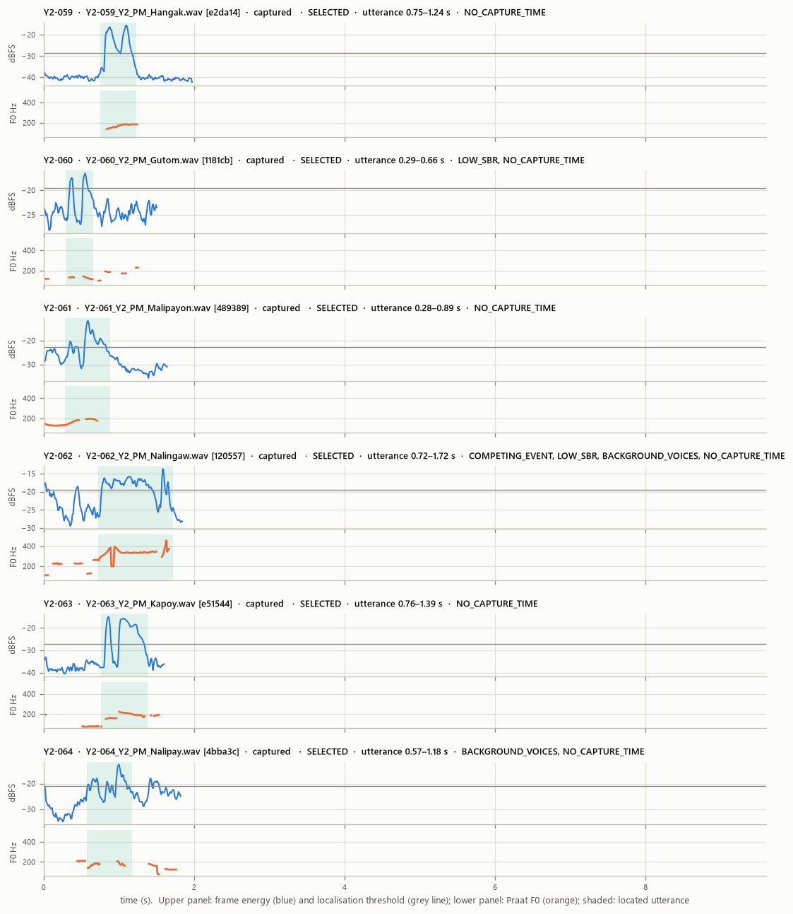
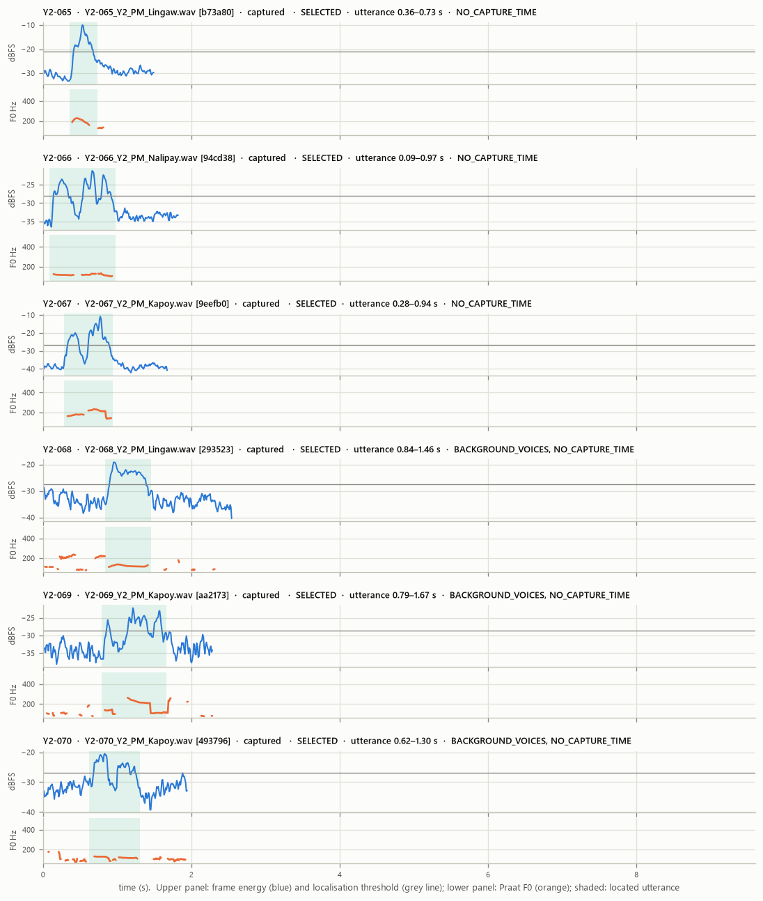
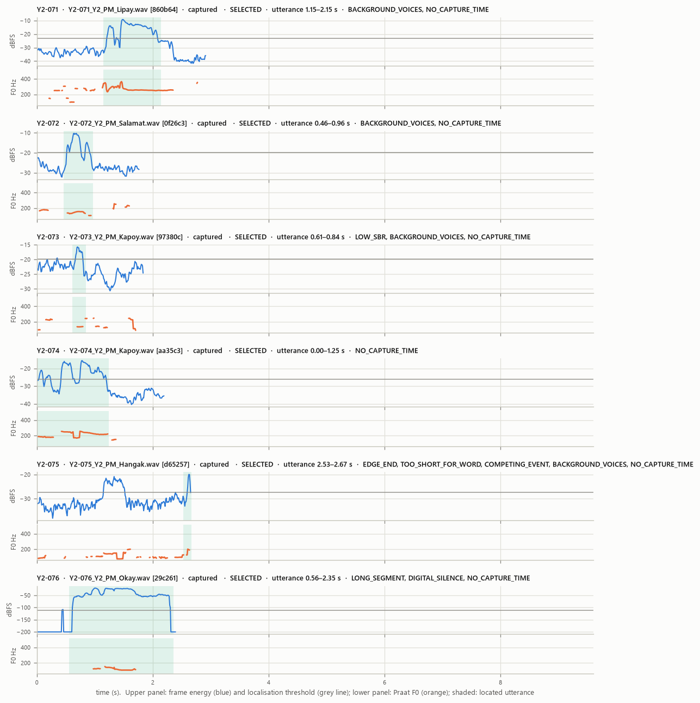
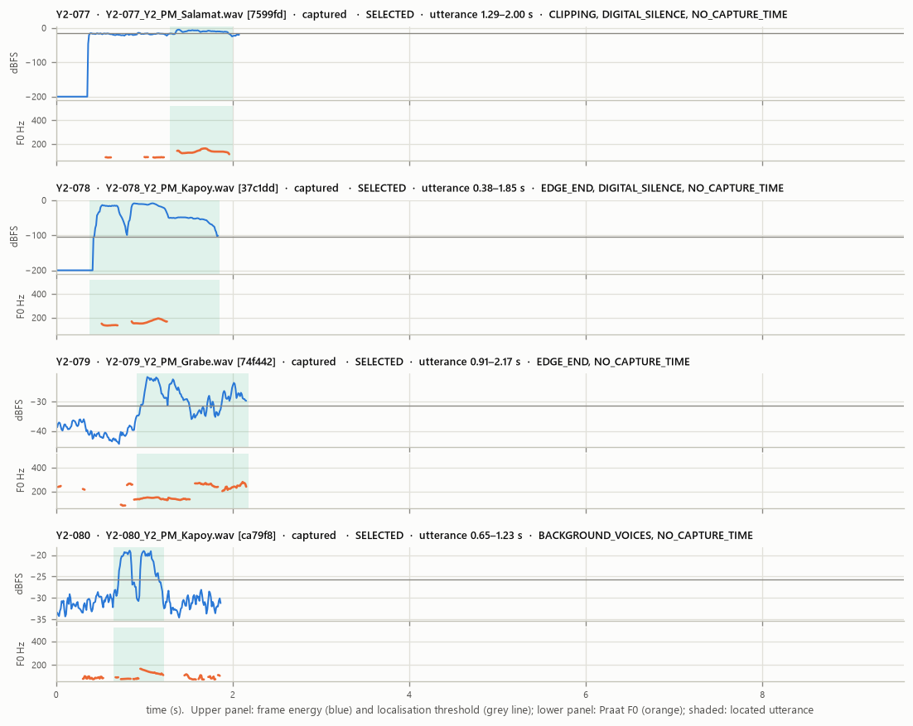

# Data Quality Report (Phases 2–5)

*Generated by `src/03_prepare_audio.py` on 2026-10-04T07:09:14+08:00. Every number is computed from the files. Per-recording detail: `reports/audio_quality_table.csv`; mapping: `data/processed_audio/file_mapping.csv`; participant inclusion: `data/analysis_manifest.csv`.*

## 1. Summary

| Quantity | Value |
|---|---|
| Total recordings (files) | 40 |
| Unique participants with recordings | 40 |
| Metadata participants | 40 |
| Missing recordings (participants) | 0:  |
| Participants with duplicate recordings (retakes) | 0:  (0 extra files) |
| Unreadable recordings | 0 |
| Recordings without detectable speech | 0 |
| Valid recordings (one selected usable take per participant) | 40 |
| Excluded recordings | 0 (non-selected retakes: 0; unusable: 0) |
| Selected recordings with ≥1 quality flag | 40 |
| Selected recordings with a segmentation-critical flag | 13 |
| **Participants included in the primary analysis** | **40** (protocol minimum: 40) |

## 2. Preprocessing (identical for every recording)

1. **Audio QA of the supplied files.** By the group's decision the analysis uses the `CS2B_v2_wav_16k` delivery: WAV, PCM 16-bit, mono, 16 kHz, already converted and trimmed by the supplier. The original phone recordings stay untouched in `data/raw/` and are not analysed. Peak, clipping (> 0.1% of samples at |x| ≥ 0.999), DC offset, level and inserted digital silence are measured on these files.
2. **Standardisation:** `ffmpeg -i <supplied.wav> -map 0:a:0 -vn -ac 1 -ar 16000 -c:a pcm_s16le -map_metadata -1 -fflags +bitexact -flags:a +bitexact <name>.wav`. The files are already 16 kHz mono PCM, so the samples pass through unchanged; each WAV is read back and checked to be bit-identical to the analysed samples. No filtering, denoising, normalisation, pitch or speed change.
3. **Utterance localisation** (label-blind; `common.locate_utterance`). The clips contain continuous background babble, so the participant's word is located as the dominant short-time-energy event. Frame RMS is 25 ms/10 ms in dB, smoothed over 50 ms. The floor is the 20th percentile and the threshold is the larger of floor + 6 dB and the dB mid-point between floor and peak. Dips < 0.25 s are bridged and 0.05 s of context is added on each side. The located segment is the analysis unit for acoustic features.
4. **Speech check:** Praat autocorrelation pitch (75–500 Hz) must find ≥ 5 voiced frames inside the segment.
5. **One take per participant:** see §5.
6. **Naming:** `ParticipantCode_YearLevel_Session_Word.wav`. Session token `PM` (ASSUMPTION from the §XII example). A missing spoken word is written `UNVERIFIED` and is never inferred.

**Flag definitions.**

Segmentation-critical (excluded in the high-confidence sensitivity analysis):
- `EDGE_START` / `EDGE_END`: the event touches the clip boundary, so the word may be cut off.
- `LONG_SEGMENT`: the event is longer than 1.5 s and may contain more than one word.
- `TOO_SHORT_FOR_WORD`: the energy event lasts less than 0.1 s per syllable of the recorded word (faster than 10 syllables/s), so it cannot hold the whole word. Syllables are counted as vowel letters, which suits Cebuano spelling (y and w are glides; maayo = ma-a-yo).
- `COMPETING_EVENT`: another event lies within 3.0 dB of the peak, ≥ 0.3 s away, so the target is ambiguous.

Quality notes:
- `LOW_SBR`: the event is less than 10.0 dB above the background.
- `CLIPPING`.
- `BACKGROUND_VOICES`: ≥ 0.3 s of voicing outside the event (other speakers).
- `LONG_CLIP`: the clip is longer than 4 s.
- `CAPTURE_TIME_OUTLIER`: captured more than 60 min from the median capture time.
- `RECORDING_CONFIG_DIFFERS`: the channels or number of audio streams differ from the majority of recordings.
- `DIGITAL_SILENCE`: at least 50 ms of exact zeros, which a phone recording never contains: the file was edited (for example silence inserted).
- `NO_CAPTURE_TIME`: the file carries no capture time (true of every converted WAV).

## 3. Per-recording quality table (all files)

| participant_code | drive_name | capture_time | orig_duration_s | orig_channels | peak_dbfs | clip_pct | sbr_db | seg_start_s | seg_end_s | voiced_frames_in_segment | flags | usable | duplicate_status | selected | standardized_filename | exclusion_reason |
|---|---|---|---|---|---|---|---|---|---|---|---|---|---|---|---|---|
| Y2-041 | Y2-041_Y2_PM_Katulgon.wav | — | 1.9 | mono | -8.51 | 0.0 | 9.88 | 0.25 | 0.935 | 40 | LOW_SBR, NO_CAPTURE_TIME | True | single | True | Y2-041_Y2_PM_Katulgon.wav | — |
| Y2-042 | Y2-042_Y2_PM_Kapoy.wav | — | 1.9 | mono | -8.82 | 0.0 | 14.84 | 0.24 | 0.655 | 36 | NO_CAPTURE_TIME | True | single | True | Y2-042_Y2_PM_Kapoy.wav | — |
| Y2-043 | Y2-043_Y2_PM_Lipay.wav | — | 1.54 | mono | -8.07 | 0.0 | 8.68 | 0.32 | 0.685 | 9 | LOW_SBR, NO_CAPTURE_TIME | True | single | True | Y2-043_Y2_PM_Lipay.wav | — |
| Y2-044 | Y2-044_Y2_PM_Salamat.wav | — | 1.76 | mono | -5.36 | 0.0 | 9.48 | 0.46 | 1.165 | 54 | LOW_SBR, BACKGROUND_VOICES, NO_CAPTURE_TIME | True | single | True | Y2-044_Y2_PM_Salamat.wav | — |
| Y2-045 | Y2-045_Y2_PM_Maayo.wav | — | 1.61 | mono | -0.58 | 0.0 | 15.22 | 0.38 | 0.705 | 27 | TOO_SHORT_FOR_WORD, BACKGROUND_VOICES, NO_CAPTURE_TIME | True | single | True | Y2-045_Y2_PM_Maayo.wav | — |
| Y2-046 | Y2-046_Y2_PM_Tsadahan.wav | — | 1.89 | mono | -7.82 | 0.0 | 8.96 | 0.78 | 1.245 | 19 | COMPETING_EVENT, LOW_SBR, NO_CAPTURE_TIME | True | single | True | Y2-046_Y2_PM_Salamat.wav | — |
| Y2-047 | Y2-047_Y2_PM_Milamdag.wav | — | 1.83 | mono | -6.33 | 0.0 | 16.48 | 0.4 | 0.955 | 48 | NO_CAPTURE_TIME | True | single | True | Y2-047_Y2_PM_Milamdag.wav | — |
| Y2-048 | Y2-048_Y2_PM_Kapoy.wav | — | 1.87 | mono | -18.45 | 0.0 | 8.74 | 0.73 | 0.935 | 11 | TOO_SHORT_FOR_WORD, LOW_SBR, NO_CAPTURE_TIME | True | single | True | Y2-048_Y2_PM_Kapoy.wav | — |
| Y2-049 | Y2-049_Y2_PM_Okay.wav | — | 1.88 | mono | -6.37 | 0.0 | 9.84 | 0.34 | 1.115 | 53 | COMPETING_EVENT, LOW_SBR, BACKGROUND_VOICES, NO_CAPTURE_TIME | True | single | True | Y2-049_Y2_PM_Okay.wav | — |
| Y2-050 | Y2-050.wav | — | 1.3 | mono | -8.84 | 0.0 | 17.16 | 0.36 | 1.055 | 48 | NO_CAPTURE_TIME | True | single | True | Y2-050_Y2_PM_Kapoy.wav | — |
| Y2-051 | Y2-051_Y2_PM_Gutom.wav | — | 1.91 | mono | -13.0 | 0.0 | 11.3 | 0.0 | 1.115 | 89 | EDGE_START, NO_CAPTURE_TIME | True | single | True | Y2-051_Y2_PM_Gutom.wav | — |
| Y2-052 | Y2-052_Y2_PM_Kapoy.wav | — | 1.34 | mono | -9.45 | 0.0 | 11.61 | 0.27 | 0.485 | 16 | TOO_SHORT_FOR_WORD, NO_CAPTURE_TIME | True | single | True | Y2-052_Y2_PM_Kapoy.wav | — |
| Y2-053 | Y2-053_Y2_PM_Kapoy.wav | — | 2.09 | mono | -8.76 | 0.0 | 18.12 | 0.0 | 0.645 | 55 | BACKGROUND_VOICES, NO_CAPTURE_TIME | True | single | True | Y2-053_Y2_PM_UNVERIFIED.wav | — |
| Y2-054 | Y2-054_Y2_PM_Nalipay.wav | — | 1.6 | mono | -0.88 | 0.0 | 17.32 | 0.17 | 0.965 | 64 | NO_CAPTURE_TIME | True | single | True | Y2-054_Y2_PM_Nalipay.wav | — |
| Y2-055 | Y2-055_Y2_PM_Nalingaw.wav | — | 1.83 | mono | -3.5 | 0.0 | 11.75 | 0.46 | 0.685 | 17 | TOO_SHORT_FOR_WORD, COMPETING_EVENT, BACKGROUND_VOICES, NO_CAPTURE_TIME | True | single | True | Y2-055_Y2_PM_Nalingaw.wav | — |
| Y2-056 | Y2-056_Y2_PM_Libog.wav | — | 1.63 | mono | -6.67 | 0.0 | 9.89 | 0.36 | 0.855 | 48 | LOW_SBR, BACKGROUND_VOICES, NO_CAPTURE_TIME | True | single | True | Y2-056_Y2_PM_Liboga.wav | — |
| Y2-057 | Y2-057_Y2_PM_Katulgon.wav | — | 1.81 | mono | -4.64 | 0.0 | 13.07 | 0.27 | 0.885 | 45 | COMPETING_EVENT, NO_CAPTURE_TIME | True | single | True | Y2-057_Y2_PM_Katulgon.wav | — |
| Y2-058 | Y2-058_Y2_PM_Kapoy.wav | — | 1.69 | mono | -8.26 | 0.0 | 14.94 | 0.46 | 1.005 | 39 | NO_CAPTURE_TIME | True | single | True | Y2-058_Y2_PM_Kapoy.wav | — |
| Y2-059 | Y2-059_Y2_PM_Hangak.wav | — | 1.99 | mono | -6.32 | 0.0 | 24.21 | 0.75 | 1.235 | 41 | NO_CAPTURE_TIME | True | single | True | Y2-059_Y2_PM_Kapoy.wav | — |
| Y2-060 | Y2-060_Y2_PM_Gutom.wav | — | 1.52 | mono | -7.59 | 0.0 | 8.39 | 0.29 | 0.655 | 22 | LOW_SBR, NO_CAPTURE_TIME | True | single | True | Y2-060_Y2_PM_Gutom.wav | — |
| Y2-061 | Y2-061_Y2_PM_Malipayon.wav | — | 1.66 | mono | -3.69 | 0.0 | 18.93 | 0.28 | 0.885 | 36 | NO_CAPTURE_TIME | True | single | True | Y2-061_Y2_PM_Malipay.wav | — |
| Y2-062 | Y2-062_Y2_PM_Nalingaw.wav | — | 1.86 | mono | -6.37 | 0.0 | 9.6 | 0.72 | 1.715 | 90 | COMPETING_EVENT, LOW_SBR, BACKGROUND_VOICES, NO_CAPTURE_TIME | True | single | True | Y2-062_Y2_PM_Nalingaw.wav | — |
| Y2-063 | Y2-063_Y2_PM_Kapoy.wav | — | 1.62 | mono | -7.91 | 0.0 | 22.28 | 0.76 | 1.385 | 53 | NO_CAPTURE_TIME | True | single | True | Y2-063_Y2_PM_Kapoy.wav | — |
| Y2-064 | Y2-064_Y2_PM_Nalipay.wav | — | 1.84 | mono | -4.92 | 0.0 | 14.67 | 0.57 | 1.175 | 29 | BACKGROUND_VOICES, NO_CAPTURE_TIME | True | single | True | Y2-064_Y2_PM_Nalipay.wav | — |
| Y2-065 | Y2-065_Y2_PM_Lingaw.wav | — | 1.51 | mono | -2.01 | 0.0 | 18.96 | 0.36 | 0.735 | 24 | NO_CAPTURE_TIME | True | single | True | Y2-065_Y2_PM_Lingaw.wav | — |
| Y2-066 | Y2-066_Y2_PM_Nalipay.wav | — | 1.84 | mono | -13.57 | 0.0 | 11.84 | 0.09 | 0.975 | 68 | NO_CAPTURE_TIME | True | single | True | Y2-066_Y2_PM_Salamat.wav | — |
| Y2-067 | Y2-067_Y2_PM_Kapoy.wav | — | 1.69 | mono | -4.58 | 0.0 | 25.52 | 0.28 | 0.945 | 55 | NO_CAPTURE_TIME | True | single | True | Y2-067_Y2_PM_Kapoy.wav | — |
| Y2-068 | Y2-068_Y2_PM_Lingaw.wav | — | 2.56 | mono | -11.57 | 0.0 | 15.57 | 0.84 | 1.455 | 54 | BACKGROUND_VOICES, NO_CAPTURE_TIME | True | single | True | Y2-068_Y2_PM_Lingaw.wav | — |
| Y2-069 | Y2-069_Y2_PM_Kapoy.wav | — | 2.3 | mono | -15.61 | 0.0 | 10.5 | 0.79 | 1.665 | 68 | BACKGROUND_VOICES, NO_CAPTURE_TIME | True | single | True | Y2-069_Y2_PM_Kapoy.wav | — |
| Y2-070 | Y2-070_Y2_PM_Kapoy.wav | — | 1.96 | mono | -11.4 | 0.0 | 11.84 | 0.62 | 1.305 | 54 | BACKGROUND_VOICES, NO_CAPTURE_TIME | True | single | True | Y2-070_Y2_PM_Kapoy.wav | — |
| Y2-071 | Y2-071_Y2_PM_Lipay.wav | — | 2.93 | mono | -1.26 | 0.0 | 26.53 | 1.15 | 2.145 | 100 | BACKGROUND_VOICES, NO_CAPTURE_TIME | True | single | True | Y2-071_Y2_PM_UNVERIFIED.wav | — |
| Y2-072 | Y2-072_Y2_PM_Salamat.wav | — | 1.78 | mono | -0.7 | 0.0 | 18.3 | 0.46 | 0.965 | 37 | BACKGROUND_VOICES, NO_CAPTURE_TIME | True | single | True | Y2-072_Y2_PM_Nalipay.wav | — |
| Y2-073 | Y2-073_Y2_PM_Kapoy.wav | — | 1.85 | mono | -4.28 | 0.0 | 9.61 | 0.61 | 0.845 | 13 | LOW_SBR, BACKGROUND_VOICES, NO_CAPTURE_TIME | True | single | True | Y2-073_Y2_PM_UNVERIFIED.wav | — |
| Y2-074 | Y2-074_Y2_PM_Kapoy.wav | — | 2.21 | mono | -6.31 | 0.0 | 19.58 | 0.0 | 1.245 | 108 | NO_CAPTURE_TIME | True | single | True | Y2-074_Y2_PM_UNVERIFIED.wav | — |
| Y2-075 | Y2-075_Y2_PM_Hangak.wav | — | 2.67 | mono | -12.29 | 0.0 | 11.49 | 2.53 | 2.665 | 7 | EDGE_END, TOO_SHORT_FOR_WORD, COMPETING_EVENT, BACKGROUND_VOICES, NO_CAPTURE_TIME | True | single | True | Y2-075_Y2_PM_Hangak.wav | — |
| Y2-076 | Y2-076_Y2_PM_Okay.wav | — | 2.41 | mono | -8.59 | 0.0 | 179.08 | 0.56 | 2.355 | 67 | LONG_SEGMENT, DIGITAL_SILENCE, NO_CAPTURE_TIME | True | single | True | Y2-076_Y2_PM_UNVERIFIED.wav | — |
| Y2-077 | Y2-077_Y2_PM_Salamat.wav | — | 2.09 | mono | 0.0 | 0.269 | 16.09 | 1.29 | 2.005 | 60 | CLIPPING, DIGITAL_SILENCE, NO_CAPTURE_TIME | True | single | True | Y2-077_Y2_PM_UNVERIFIED.wav | — |
| Y2-078 | Y2-078_Y2_PM_Kapoy.wav | — | 1.85 | mono | -1.61 | 0.0 | 190.84 | 0.38 | 1.85 | 60 | EDGE_END, DIGITAL_SILENCE, NO_CAPTURE_TIME | True | single | True | Y2-078_Y2_PM_UNVERIFIED.wav | — |
| Y2-079 | Y2-079_Y2_PM_Grabe.wav | — | 2.17 | mono | -13.62 | 0.0 | 18.65 | 0.91 | 2.175 | 116 | EDGE_END, NO_CAPTURE_TIME | True | single | True | Y2-079_Y2_PM_UNVERIFIED.wav | — |
| Y2-080 | Y2-080_Y2_PM_Kapoy.wav | — | 1.88 | mono | -9.26 | 0.0 | 12.51 | 0.65 | 1.225 | 50 | BACKGROUND_VOICES, NO_CAPTURE_TIME | True | single | True | Y2-080_Y2_PM_UNVERIFIED.wav | — |

## 4. Participant-level status (all metadata participants)

| participant_code | n_takes | include_primary | exclusion_reason | selected_file | selected_flags |
|---|---|---|---|---|---|
| Y2-041 | 1 | True | — | Y2-041_Y2_PM_Katulgon.wav | LOW_SBR, NO_CAPTURE_TIME |
| Y2-042 | 1 | True | — | Y2-042_Y2_PM_Kapoy.wav | NO_CAPTURE_TIME |
| Y2-043 | 1 | True | — | Y2-043_Y2_PM_Lipay.wav | LOW_SBR, NO_CAPTURE_TIME |
| Y2-044 | 1 | True | — | Y2-044_Y2_PM_Salamat.wav | LOW_SBR, BACKGROUND_VOICES, NO_CAPTURE_TIME |
| Y2-045 | 1 | True | — | Y2-045_Y2_PM_Maayo.wav | TOO_SHORT_FOR_WORD, BACKGROUND_VOICES, NO_CAPTURE_TIME |
| Y2-046 | 1 | True | — | Y2-046_Y2_PM_Salamat.wav | COMPETING_EVENT, LOW_SBR, NO_CAPTURE_TIME |
| Y2-047 | 1 | True | — | Y2-047_Y2_PM_Milamdag.wav | NO_CAPTURE_TIME |
| Y2-048 | 1 | True | — | Y2-048_Y2_PM_Kapoy.wav | TOO_SHORT_FOR_WORD, LOW_SBR, NO_CAPTURE_TIME |
| Y2-049 | 1 | True | — | Y2-049_Y2_PM_Okay.wav | COMPETING_EVENT, LOW_SBR, BACKGROUND_VOICES, NO_CAPTURE_TIME |
| Y2-050 | 1 | True | — | Y2-050_Y2_PM_Kapoy.wav | NO_CAPTURE_TIME |
| Y2-051 | 1 | True | — | Y2-051_Y2_PM_Gutom.wav | EDGE_START, NO_CAPTURE_TIME |
| Y2-052 | 1 | True | — | Y2-052_Y2_PM_Kapoy.wav | TOO_SHORT_FOR_WORD, NO_CAPTURE_TIME |
| Y2-053 | 1 | True | — | Y2-053_Y2_PM_UNVERIFIED.wav | BACKGROUND_VOICES, NO_CAPTURE_TIME |
| Y2-054 | 1 | True | — | Y2-054_Y2_PM_Nalipay.wav | NO_CAPTURE_TIME |
| Y2-055 | 1 | True | — | Y2-055_Y2_PM_Nalingaw.wav | TOO_SHORT_FOR_WORD, COMPETING_EVENT, BACKGROUND_VOICES, NO_CAPTURE_TIME |
| Y2-056 | 1 | True | — | Y2-056_Y2_PM_Liboga.wav | LOW_SBR, BACKGROUND_VOICES, NO_CAPTURE_TIME |
| Y2-057 | 1 | True | — | Y2-057_Y2_PM_Katulgon.wav | COMPETING_EVENT, NO_CAPTURE_TIME |
| Y2-058 | 1 | True | — | Y2-058_Y2_PM_Kapoy.wav | NO_CAPTURE_TIME |
| Y2-059 | 1 | True | — | Y2-059_Y2_PM_Kapoy.wav | NO_CAPTURE_TIME |
| Y2-060 | 1 | True | — | Y2-060_Y2_PM_Gutom.wav | LOW_SBR, NO_CAPTURE_TIME |
| Y2-061 | 1 | True | — | Y2-061_Y2_PM_Malipay.wav | NO_CAPTURE_TIME |
| Y2-062 | 1 | True | — | Y2-062_Y2_PM_Nalingaw.wav | COMPETING_EVENT, LOW_SBR, BACKGROUND_VOICES, NO_CAPTURE_TIME |
| Y2-063 | 1 | True | — | Y2-063_Y2_PM_Kapoy.wav | NO_CAPTURE_TIME |
| Y2-064 | 1 | True | — | Y2-064_Y2_PM_Nalipay.wav | BACKGROUND_VOICES, NO_CAPTURE_TIME |
| Y2-065 | 1 | True | — | Y2-065_Y2_PM_Lingaw.wav | NO_CAPTURE_TIME |
| Y2-066 | 1 | True | — | Y2-066_Y2_PM_Salamat.wav | NO_CAPTURE_TIME |
| Y2-067 | 1 | True | — | Y2-067_Y2_PM_Kapoy.wav | NO_CAPTURE_TIME |
| Y2-068 | 1 | True | — | Y2-068_Y2_PM_Lingaw.wav | BACKGROUND_VOICES, NO_CAPTURE_TIME |
| Y2-069 | 1 | True | — | Y2-069_Y2_PM_Kapoy.wav | BACKGROUND_VOICES, NO_CAPTURE_TIME |
| Y2-070 | 1 | True | — | Y2-070_Y2_PM_Kapoy.wav | BACKGROUND_VOICES, NO_CAPTURE_TIME |
| Y2-071 | 1 | True | — | Y2-071_Y2_PM_UNVERIFIED.wav | BACKGROUND_VOICES, NO_CAPTURE_TIME |
| Y2-072 | 1 | True | — | Y2-072_Y2_PM_Nalipay.wav | BACKGROUND_VOICES, NO_CAPTURE_TIME |
| Y2-073 | 1 | True | — | Y2-073_Y2_PM_UNVERIFIED.wav | LOW_SBR, BACKGROUND_VOICES, NO_CAPTURE_TIME |
| Y2-074 | 1 | True | — | Y2-074_Y2_PM_UNVERIFIED.wav | NO_CAPTURE_TIME |
| Y2-075 | 1 | True | — | Y2-075_Y2_PM_Hangak.wav | EDGE_END, TOO_SHORT_FOR_WORD, COMPETING_EVENT, BACKGROUND_VOICES, NO_CAPTURE_TIME |
| Y2-076 | 1 | True | — | Y2-076_Y2_PM_UNVERIFIED.wav | LONG_SEGMENT, DIGITAL_SILENCE, NO_CAPTURE_TIME |
| Y2-077 | 1 | True | — | Y2-077_Y2_PM_UNVERIFIED.wav | CLIPPING, DIGITAL_SILENCE, NO_CAPTURE_TIME |
| Y2-078 | 1 | True | — | Y2-078_Y2_PM_UNVERIFIED.wav | EDGE_END, DIGITAL_SILENCE, NO_CAPTURE_TIME |
| Y2-079 | 1 | True | — | Y2-079_Y2_PM_UNVERIFIED.wav | EDGE_END, NO_CAPTURE_TIME |
| Y2-080 | 1 | True | — | Y2-080_Y2_PM_UNVERIFIED.wav | BACKGROUND_VOICES, NO_CAPTURE_TIME |

## 5. Source of the audio

The delivery has one file per participant, so there are no retakes to resolve here. Its provenance was audited while the original recordings were still analysed (`reports/supplied_audio_audit.md`): **31** files are trimmed copies of the participant's original, and **9** have no verified original (Y2-053, Y2-071, Y2-074, Y2-075, Y2-076, Y2-077, Y2-078, Y2-079, Y2-080). For participants recorded more than once, the delivery's take is used as supplied. 3 files contain inserted digital silence or clipping (Y2-076, Y2-077, Y2-078).

Sensitivity analyses repeat the models without the files that have no verified original, and without the edited or clipped files.

| participant_code | audio_source | selected_file | selected_flags |
|---|---|---|---|
| Y2-041 | CS2B_v2_wav_16k: COPY_OF_ORIGINAL | Y2-041_Y2_PM_Katulgon.wav | LOW_SBR, NO_CAPTURE_TIME |
| Y2-042 | CS2B_v2_wav_16k: COPY_OF_ORIGINAL | Y2-042_Y2_PM_Kapoy.wav | NO_CAPTURE_TIME |
| Y2-043 | CS2B_v2_wav_16k: COPY_OF_ORIGINAL | Y2-043_Y2_PM_Lipay.wav | LOW_SBR, NO_CAPTURE_TIME |
| Y2-044 | CS2B_v2_wav_16k: COPY_OF_ORIGINAL | Y2-044_Y2_PM_Salamat.wav | LOW_SBR, BACKGROUND_VOICES, NO_CAPTURE_TIME |
| Y2-045 | CS2B_v2_wav_16k: COPY_OF_ORIGINAL | Y2-045_Y2_PM_Maayo.wav | TOO_SHORT_FOR_WORD, BACKGROUND_VOICES, NO_CAPTURE_TIME |
| Y2-046 | CS2B_v2_wav_16k: COPY_OF_ORIGINAL | Y2-046_Y2_PM_Salamat.wav | COMPETING_EVENT, LOW_SBR, NO_CAPTURE_TIME |
| Y2-047 | CS2B_v2_wav_16k: COPY_OF_ORIGINAL | Y2-047_Y2_PM_Milamdag.wav | NO_CAPTURE_TIME |
| Y2-048 | CS2B_v2_wav_16k: COPY_OF_ORIGINAL | Y2-048_Y2_PM_Kapoy.wav | TOO_SHORT_FOR_WORD, LOW_SBR, NO_CAPTURE_TIME |
| Y2-049 | CS2B_v2_wav_16k: COPY_OF_ORIGINAL | Y2-049_Y2_PM_Okay.wav | COMPETING_EVENT, LOW_SBR, BACKGROUND_VOICES, NO_CAPTURE_TIME |
| Y2-050 | CS2B_v2_wav_16k: COPY_OF_ORIGINAL | Y2-050_Y2_PM_Kapoy.wav | NO_CAPTURE_TIME |
| Y2-051 | CS2B_v2_wav_16k: COPY_OF_ORIGINAL | Y2-051_Y2_PM_Gutom.wav | EDGE_START, NO_CAPTURE_TIME |
| Y2-052 | CS2B_v2_wav_16k: COPY_OF_ORIGINAL | Y2-052_Y2_PM_Kapoy.wav | TOO_SHORT_FOR_WORD, NO_CAPTURE_TIME |
| Y2-053 | CS2B_v2_wav_16k: NEW_RECORDING | Y2-053_Y2_PM_UNVERIFIED.wav | BACKGROUND_VOICES, NO_CAPTURE_TIME |
| Y2-054 | CS2B_v2_wav_16k: COPY_OF_ORIGINAL | Y2-054_Y2_PM_Nalipay.wav | NO_CAPTURE_TIME |
| Y2-055 | CS2B_v2_wav_16k: COPY_OF_ORIGINAL | Y2-055_Y2_PM_Nalingaw.wav | TOO_SHORT_FOR_WORD, COMPETING_EVENT, BACKGROUND_VOICES, NO_CAPTURE_TIME |
| Y2-056 | CS2B_v2_wav_16k: COPY_OF_ORIGINAL | Y2-056_Y2_PM_Liboga.wav | LOW_SBR, BACKGROUND_VOICES, NO_CAPTURE_TIME |
| Y2-057 | CS2B_v2_wav_16k: COPY_OF_ORIGINAL | Y2-057_Y2_PM_Katulgon.wav | COMPETING_EVENT, NO_CAPTURE_TIME |
| Y2-058 | CS2B_v2_wav_16k: COPY_OF_ORIGINAL | Y2-058_Y2_PM_Kapoy.wav | NO_CAPTURE_TIME |
| Y2-059 | CS2B_v2_wav_16k: COPY_OF_ORIGINAL | Y2-059_Y2_PM_Kapoy.wav | NO_CAPTURE_TIME |
| Y2-060 | CS2B_v2_wav_16k: COPY_OF_ORIGINAL | Y2-060_Y2_PM_Gutom.wav | LOW_SBR, NO_CAPTURE_TIME |
| Y2-061 | CS2B_v2_wav_16k: COPY_OF_ORIGINAL | Y2-061_Y2_PM_Malipay.wav | NO_CAPTURE_TIME |
| Y2-062 | CS2B_v2_wav_16k: COPY_OF_ORIGINAL | Y2-062_Y2_PM_Nalingaw.wav | COMPETING_EVENT, LOW_SBR, BACKGROUND_VOICES, NO_CAPTURE_TIME |
| Y2-063 | CS2B_v2_wav_16k: COPY_OF_ORIGINAL | Y2-063_Y2_PM_Kapoy.wav | NO_CAPTURE_TIME |
| Y2-064 | CS2B_v2_wav_16k: COPY_OF_ORIGINAL | Y2-064_Y2_PM_Nalipay.wav | BACKGROUND_VOICES, NO_CAPTURE_TIME |
| Y2-065 | CS2B_v2_wav_16k: COPY_OF_ORIGINAL | Y2-065_Y2_PM_Lingaw.wav | NO_CAPTURE_TIME |
| Y2-066 | CS2B_v2_wav_16k: COPY_OF_ORIGINAL | Y2-066_Y2_PM_Salamat.wav | NO_CAPTURE_TIME |
| Y2-067 | CS2B_v2_wav_16k: COPY_OF_ORIGINAL | Y2-067_Y2_PM_Kapoy.wav | NO_CAPTURE_TIME |
| Y2-068 | CS2B_v2_wav_16k: COPY_OF_ORIGINAL | Y2-068_Y2_PM_Lingaw.wav | BACKGROUND_VOICES, NO_CAPTURE_TIME |
| Y2-069 | CS2B_v2_wav_16k: COPY_OF_ORIGINAL | Y2-069_Y2_PM_Kapoy.wav | BACKGROUND_VOICES, NO_CAPTURE_TIME |
| Y2-070 | CS2B_v2_wav_16k: COPY_OF_ORIGINAL | Y2-070_Y2_PM_Kapoy.wav | BACKGROUND_VOICES, NO_CAPTURE_TIME |
| Y2-071 | CS2B_v2_wav_16k: NEW_RECORDING | Y2-071_Y2_PM_UNVERIFIED.wav | BACKGROUND_VOICES, NO_CAPTURE_TIME |
| Y2-072 | CS2B_v2_wav_16k: COPY_OF_ORIGINAL | Y2-072_Y2_PM_Nalipay.wav | BACKGROUND_VOICES, NO_CAPTURE_TIME |
| Y2-073 | CS2B_v2_wav_16k: COPY_OF_ORIGINAL | Y2-073_Y2_PM_UNVERIFIED.wav | LOW_SBR, BACKGROUND_VOICES, NO_CAPTURE_TIME |
| Y2-074 | CS2B_v2_wav_16k: NEW_RECORDING | Y2-074_Y2_PM_UNVERIFIED.wav | NO_CAPTURE_TIME |
| Y2-075 | CS2B_v2_wav_16k: DIFFERENT_RECORDING | Y2-075_Y2_PM_Hangak.wav | EDGE_END, TOO_SHORT_FOR_WORD, COMPETING_EVENT, BACKGROUND_VOICES, NO_CAPTURE_TIME |
| Y2-076 | CS2B_v2_wav_16k: NEW_RECORDING | Y2-076_Y2_PM_UNVERIFIED.wav | LONG_SEGMENT, DIGITAL_SILENCE, NO_CAPTURE_TIME |
| Y2-077 | CS2B_v2_wav_16k: NEW_RECORDING | Y2-077_Y2_PM_UNVERIFIED.wav | CLIPPING, DIGITAL_SILENCE, NO_CAPTURE_TIME |
| Y2-078 | CS2B_v2_wav_16k: NEW_RECORDING | Y2-078_Y2_PM_UNVERIFIED.wav | EDGE_END, DIGITAL_SILENCE, NO_CAPTURE_TIME |
| Y2-079 | CS2B_v2_wav_16k: NEW_RECORDING | Y2-079_Y2_PM_UNVERIFIED.wav | EDGE_END, NO_CAPTURE_TIME |
| Y2-080 | CS2B_v2_wav_16k: NEW_RECORDING | Y2-080_Y2_PM_UNVERIFIED.wav | BACKGROUND_VOICES, NO_CAPTURE_TIME |

## 6. Recording configuration of the originals

5 supplied files (Y2-050, Y2-063, Y2-068, Y2-069, Y2-070) are copies of recordings made with a different audio configuration (stereo plus a second track; most captured about 9 hours after the session). The conversion keeps that acoustic difference, so the confound remains; a sensitivity analysis excludes these participants.

## 7. Segmentation review (human verification needed)

The utterance location is automatic and label-blind; nobody has listened to verify it yet. Verify it with the blind listening review (`data/review/listening_review.html`, at least two listeners; `docs/RUNNING.md` §6.1): unanimous corrections are applied automatically on the next run, and a joint decision can go into `segment_overrides.csv` (per take).

