# Exploratory Data Analysis (Phase 7)

*Generated by `src/05_eda.py`. Analysis set: the 32 participants with a usable recording (of 40 metadata rows). Tables: `reports/eda/`. Figures: `figures/eda/`. All p-values are exploratory, and associations do not imply causation.*

## 1. Self-reported affect (RQ1)

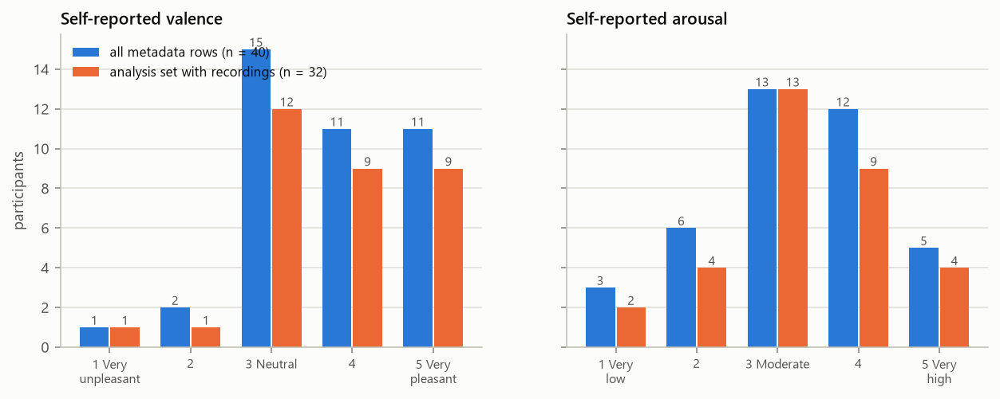

| rating | value | metadata_n | metadata_pct | analysis_n | analysis_pct |
|---|---|---|---|---|---|
| valence | 1 | 1 | 2.5 | 1 | 3.1 |
| valence | 2 | 2 | 5.0 | 1 | 3.1 |
| valence | 3 | 15 | 37.5 | 12 | 37.5 |
| valence | 4 | 11 | 27.5 | 9 | 28.1 |
| valence | 5 | 11 | 27.5 | 9 | 28.1 |
| arousal | 1 | 3 | 7.7 | 2 | 6.2 |
| arousal | 2 | 6 | 15.4 | 4 | 12.5 |
| arousal | 3 | 13 | 33.3 | 13 | 40.6 |
| arousal | 4 | 12 | 30.8 | 9 | 28.1 |
| arousal | 5 | 5 | 12.8 | 4 | 12.5 |

Metadata arousal counts exclude Y2-076, whose struck-through rating is not used. In the analysis set, valence and arousal are positively associated: Spearman ρ = 0.77, p = 3.29e-07, n = 32. Across all metadata rows with both ratings, ρ = 0.71, p = 4.01e-07, n = 39.

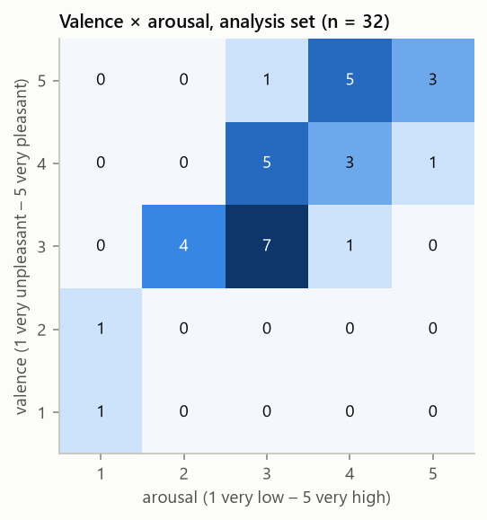

## 2. Classification targets (derived) and their viability

The original 1–5 ratings are kept. Derived groupings are *not* collected variables. A task is modelled only if every class has at least 5 participants, so each test fold of a 5-fold cross-validation can contain every class.

| task | classes | min_class | viable |
|---|---|---|---|
| valence_5 | 1: 1 / 2: 1 / 3: 12 / 4: 9 / 5: 9 | 1 | False |
| arousal_5 | 1: 2 / 2: 4 / 3: 13 / 4: 9 / 5: 4 | 2 | False |
| valence_3 | Unpleasant: 2 / Neutral: 12 / Pleasant: 18 | 2 | False |
| arousal_3 | Low: 6 / Moderate: 13 / High: 13 | 6 | True |
| valence_2 | NotPleasant: 14 / Pleasant: 18 | 14 | True |
| arousal_2 | NotHigh: 19 / High: 13 | 13 | True |

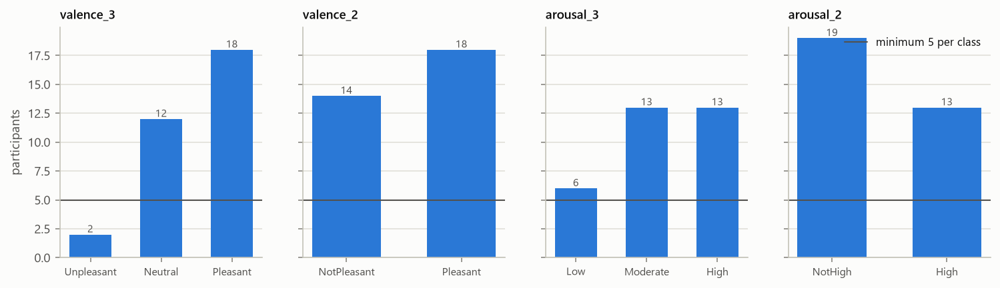

## 3. Educational context (RQ2): not analysable within Group 3

| variable | values | distinct_non_blank |
|---|---|---|
| Year Level | 2: 40 | 1 |
| Class Activity | Lecture: 40 | 1 |
| Session | Afternoon–Evening: 40 | 1 |
| Subject | Environmental Science: 30; (blank): 10 | 1 |

Year level, class activity and session each take **one value** for every Group 3 participant, and subject is one value or blank. Their association with affect (Protocol §XIII: Year Level × Affect, Class Activity × Affect, Session × Affect) **cannot be estimated from Group 3 data**. It needs the consolidated class dataset, where these variables vary.

## 4. Spoken words and feeling descriptions

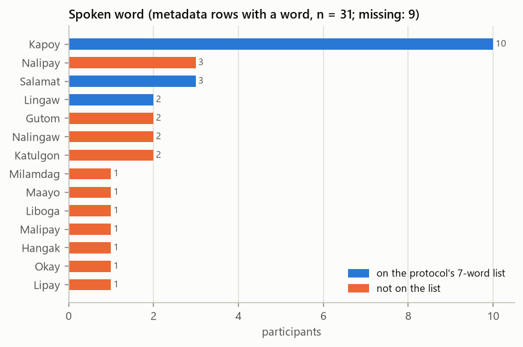

| spoken_word | n | valence_values | arousal_values | on_protocol_list |
|---|---|---|---|---|
| Kapoy | 10 | 1, 3, 3, 3, 3, 3, 3, 3, 4, 4 | 1, 2, 2, 3, 3, 3, 3, 3, 3, 4 | True |
| Salamat | 3 | 4, 5, 5 | 4, 4, 4 | True |
| Nalipay | 3 | 4, 5, 5 | 5, 5, 5 | False |
| Katulgon | 2 | 3, 3 | 2, 3 | False |
| Lingaw | 2 | 3, 5 | 4, 4 | True |
| Gutom | 2 | 3, 4 | 3, 3 | False |
| Nalingaw | 2 | 4, 5 | 3, 5 | False |
| Hangak | 1 | 3 | 2 | False |
| Liboga | 1 | 5 | 3 | False |
| Lipay | 1 | 4 | 4 | False |
| Milamdag | 1 | 5 | 4 | False |
| Malipay | 1 | 5 | 4 | False |
| Maayo | 1 | 4 | 3 | False |
| Okay | 1 | 4 | 3 | False |

Words with ≥ 8 occurrences (needed for a within-word comparison): Kapoy (10); every other word occurs at most 3 times (see `reports/lexical_control_analysis.md`).

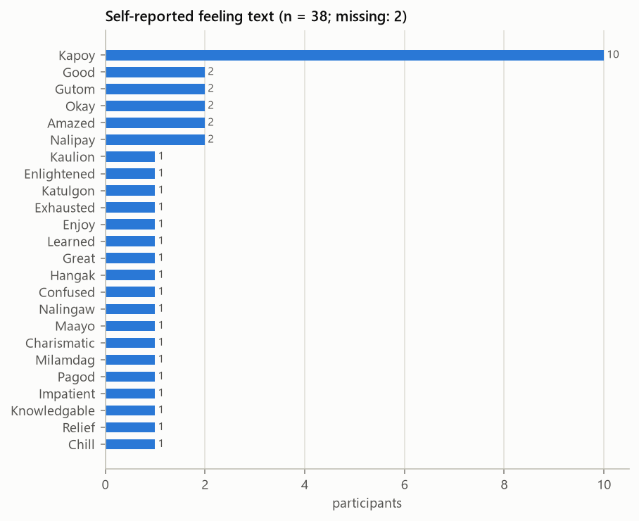

## 5. Acoustic features

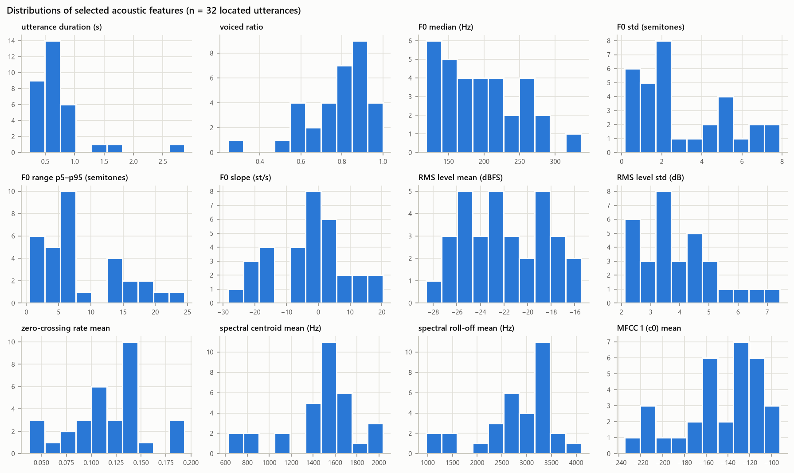

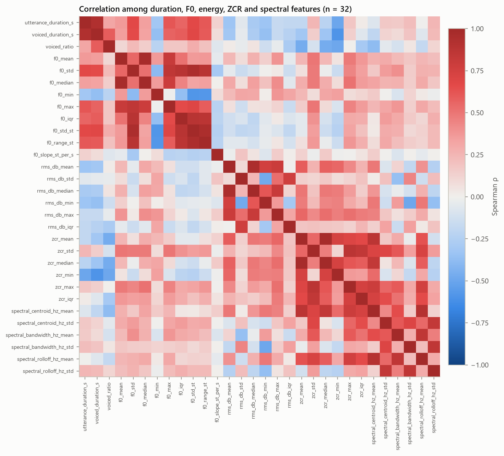

6 pairs of duration/F0/energy/ZCR/spectral features have |ρ| ≥ 0.9; the feature set is partly redundant. That is one reason models use regularisation.

## 6. Acoustic features vs self-reported affect (RQ3)

Spearman correlation of each of the 108 features with the raw ratings (n = 32), Benjamini–Hochberg FDR within each rating. **Features passing q < 0.05: valence 0, arousal 3.**

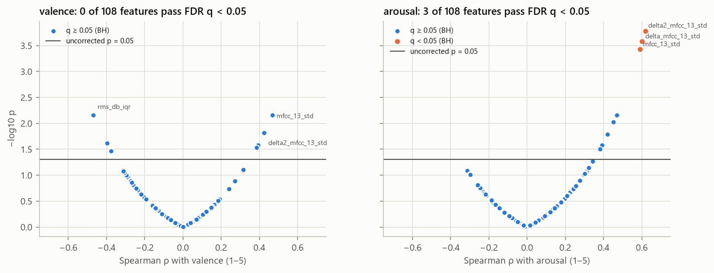

Ten smallest p-values, valence:

| feature | spearman_rho | p_value | q_value_bh |
|---|---|---|---|
| rms_db_iqr | -0.468 | 0.007 | 0.375 |
| mfcc_13_std | 0.468 | 0.007 | 0.375 |
| delta2_mfcc_13_std | 0.426 | 0.015 | 0.422 |
| delta_mfcc_13_std | 0.424 | 0.016 | 0.422 |
| delta_mfcc_2_mean | -0.397 | 0.024 | 0.450 |
| rms_db_mean | 0.393 | 0.026 | 0.450 |
| rms_db_min | 0.386 | 0.029 | 0.450 |
| delta2_mfcc_2_std | -0.376 | 0.034 | 0.457 |
| delta2_mfcc_9_std | 0.315 | 0.079 | 0.734 |
| delta_mfcc_7_mean | -0.314 | 0.080 | 0.734 |

Ten smallest p-values, arousal:

| feature | spearman_rho | p_value | q_value_bh |
|---|---|---|---|
| delta2_mfcc_13_std | 0.618 | 0.000 | 0.013 |
| delta_mfcc_13_std | 0.602 | 0.000 | 0.013 |
| mfcc_13_std | 0.590 | 0.000 | 0.013 |
| delta2_mfcc_10_std | 0.468 | 0.007 | 0.185 |
| mfcc_9_mean | 0.452 | 0.009 | 0.204 |
| delta2_mfcc_9_std | 0.422 | 0.016 | 0.293 |
| mfcc_10_std | 0.393 | 0.026 | 0.405 |
| delta_mfcc_10_std | 0.382 | 0.031 | 0.420 |
| rms_db_mean | 0.344 | 0.054 | 0.626 |
| mfcc_1_mean | 0.322 | 0.072 | 0.626 |

Six features fixed in advance (pitch level and range, loudness, duration, spectral balance, voicing), by derived class:

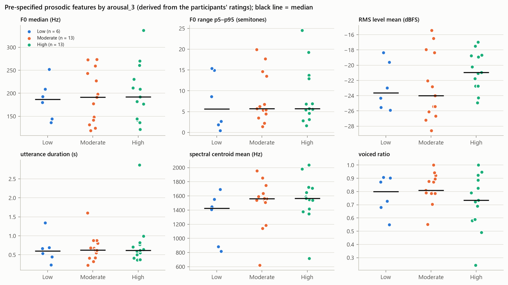

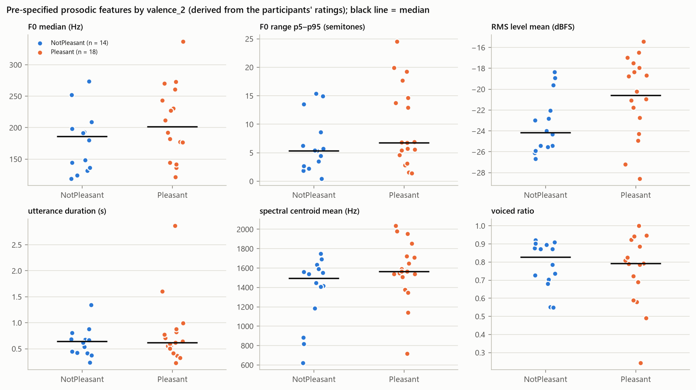

F0 in Hz mostly reflects voice type (for example sex), and no speaker baseline exists because each participant gives one utterance. Semitone measures (range, std, slope) are scale-free.

## 7. Recording condition as a confound

6 selected recordings (config B) were made with a different audio setup (stereo plus a second track; 5 captured 8.9–9.1 h after the median capture time). **20 of 108 features differ between configurations at FDR q < 0.05** (Mann–Whitney):

| feature | median_A | median_B | rank_biserial_B_vs_A | p_value | q_value_bh |
|---|---|---|---|---|---|
| mfcc_1_mean | -130.787 | -212.344 | -1.000 | 0.000 | 0.000 |
| zcr_mean | 0.133 | 0.051 | -1.000 | 0.000 | 0.000 |
| spectral_centroid_hz_mean | 1564.945 | 850.077 | -1.000 | 0.000 | 0.000 |
| spectral_rolloff_hz_mean | 3174.145 | 1414.280 | -0.962 | 0.000 | 0.000 |
| mfcc_3_mean | -13.948 | 4.839 | 0.936 | 0.000 | 0.001 |
| mfcc_2_mean | 60.457 | 90.754 | 0.936 | 0.000 | 0.001 |
| zcr_median | 0.131 | 0.045 | -0.994 | 0.000 | 0.003 |
| zcr_min | 0.062 | 0.024 | -0.962 | 0.000 | 0.004 |
| zcr_max | 0.203 | 0.105 | -0.955 | 0.000 | 0.004 |
| mfcc_8_mean | -3.300 | 4.979 | 0.833 | 0.001 | 0.007 |

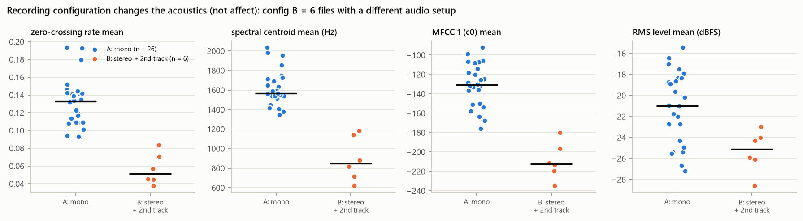

Association of configuration with the labels:

| target | test | p_value | counts |
|---|---|---|---|
| valence_2 | Fisher exact | 0.365 | A: mono: {'NotPleasant': 10, 'Pleasant': 16}; B: stereo + 2nd track: {'NotPleasant': 4, 'Pleasant': 2} |
| arousal_2 | Fisher exact | 0.361 | A: mono: {'High': 12, 'NotHigh': 14}; B: stereo + 2nd track: {'High': 1, 'NotHigh': 5} |
| arousal_3 | permutation chi-square (20,000) | 0.512 | A: mono: {'High': 12, 'Low': 4, 'Moderate': 10}; B: stereo + 2nd track: {'High': 1, 'Low': 2, 'Moderate': 3} |

Utterance-to-background ratio vs ratings (Spearman): valence ρ = 0.11 (p = 0.564); arousal ρ = 0.12 (p = 0.53).

Any acoustic feature that separates the configurations can produce a spurious affect association whenever configuration and labels are unevenly distributed. The model evaluation therefore includes a sensitivity analysis without config-B recordings.
