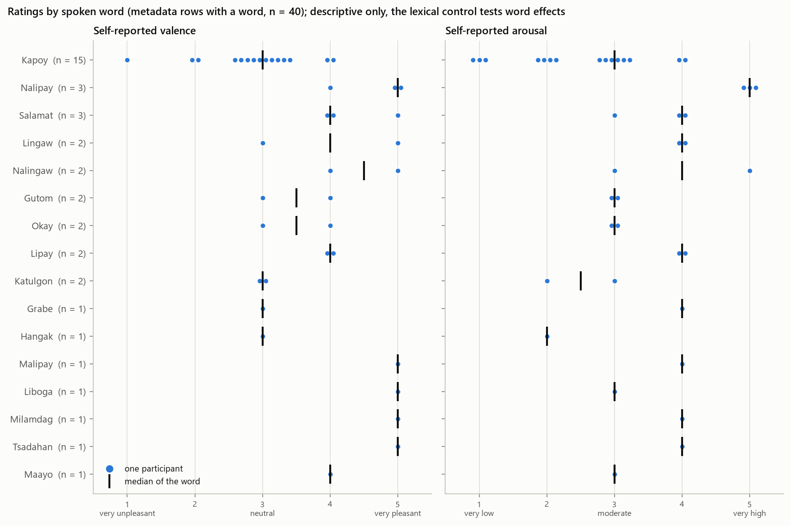
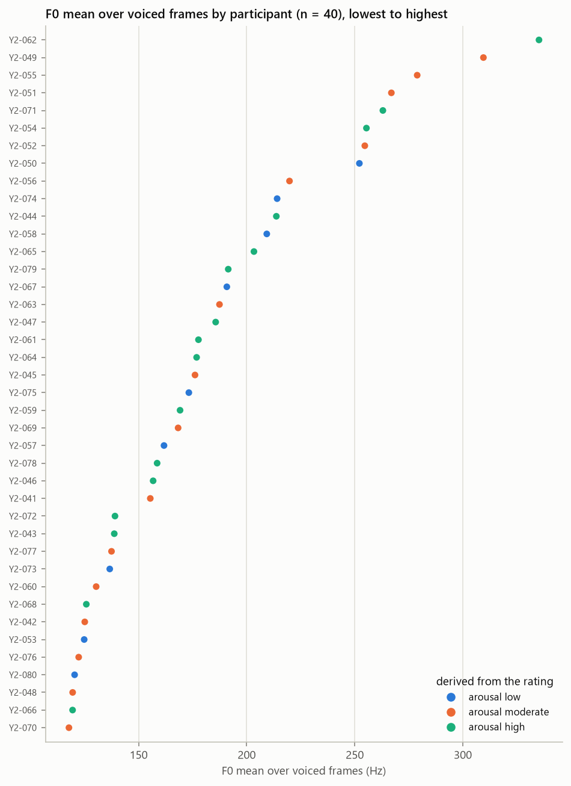
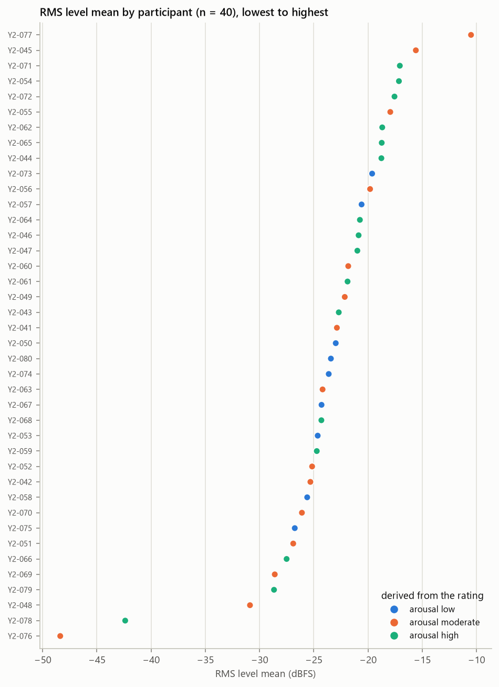
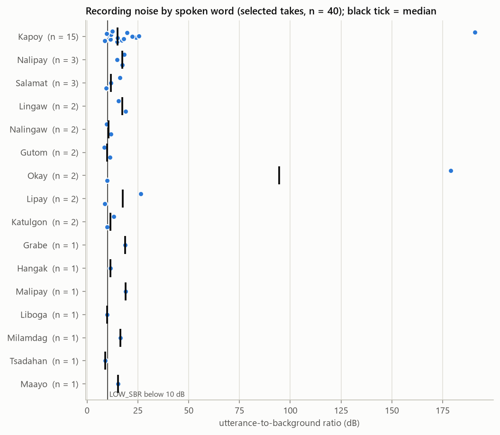

# Exploratory Data Analysis (Phase 7)

*Generated by `src/05_eda.py`. Analysis set: the 40 participants with a usable recording (of 40 metadata rows). Tables: `reports/eda/`. Figures: `figures/eda/`. All p-values are exploratory, and associations do not imply causation.*

## 1. Self-reported affect (RQ1)

| rating | value | metadata_n | metadata_pct | analysis_n | analysis_pct |
|---|---|---|---|---|---|
| valence | 1 | 1 | 2.5 | 1 | 2.5 |
| valence | 2 | 2 | 5.0 | 2 | 5.0 |
| valence | 3 | 17 | 42.5 | 17 | 42.5 |
| valence | 4 | 11 | 27.5 | 11 | 27.5 |
| valence | 5 | 9 | 22.5 | 9 | 22.5 |
| arousal | 1 | 3 | 7.5 | 3 | 7.5 |
| arousal | 2 | 6 | 15.0 | 6 | 15.0 |
| arousal | 3 | 15 | 37.5 | 15 | 37.5 |
| arousal | 4 | 12 | 30.0 | 12 | 30.0 |
| arousal | 5 | 4 | 10.0 | 4 | 10.0 |

Metadata arousal counts exclude , whose struck-through rating is not used. In the analysis set, valence and arousal are positively associated: Spearman ρ = 0.72, p = 1.33e-07, n = 40. Across all metadata rows with both ratings, ρ = 0.72, p = 1.33e-07, n = 40.

## 2. Classification targets (derived) and their viability

The original 1–5 ratings are kept. Derived groupings are *not* collected variables. A task is modelled only if every class has at least 5 participants, so each test fold of a 5-fold cross-validation can contain every class.

| task | classes | min_class | viable |
|---|---|---|---|
| valence_5 | 1: 1 / 2: 2 / 3: 17 / 4: 11 / 5: 9 | 1 | False |
| arousal_5 | 1: 3 / 2: 6 / 3: 15 / 4: 12 / 5: 4 | 3 | False |
| valence_3 | Unpleasant: 3 / Neutral: 17 / Pleasant: 20 | 3 | False |
| arousal_3 | Low: 9 / Moderate: 15 / High: 16 | 9 | True |
| valence_2 | NotPleasant: 20 / Pleasant: 20 | 20 | True |
| arousal_2 | NotHigh: 24 / High: 16 | 16 | True |

## 3. Educational context (RQ2): not analysable within Group 3

| variable | values | distinct_non_blank |
|---|---|---|
| Year Level | 2: 40 | 1 |
| Class Activity | Lecture: 40 | 1 |
| Session | Afternoon–Evening: 40 | 1 |
| Subject | Environmental Science: 40 | 1 |

Year level, class activity and session each take **one value** for every Group 3 participant, and subject is one value or blank. Their association with affect (Protocol §XIII: Year Level × Affect, Class Activity × Affect, Session × Affect) **cannot be estimated from Group 3 data**. It needs the consolidated class dataset, where these variables vary.

## 4. Spoken words and feeling descriptions

| spoken_word | n | valence_values | arousal_values | on_protocol_list |
|---|---|---|---|---|
| Kapoy | 15 | 1, 2, 2, 3, 3, 3, 3, 3, 3, 3, 3, 3, 3, 4, 4 | 1, 1, 1, 2, 2, 2, 2, 3, 3, 3, 3, 3, 3, 4, 4 | True |
| Salamat | 3 | 4, 4, 5 | 3, 4, 4 | True |
| Nalipay | 3 | 4, 5, 5 | 5, 5, 5 | False |
| Gutom | 2 | 3, 4 | 3, 3 | False |
| Lipay | 2 | 4, 4 | 4, 4 | False |
| Nalingaw | 2 | 4, 5 | 3, 5 | False |
| Lingaw | 2 | 3, 5 | 4, 4 | True |
| Katulgon | 2 | 3, 3 | 2, 3 | False |
| Okay | 2 | 3, 4 | 3, 3 | False |
| Liboga | 1 | 5 | 3 | False |
| Grabe | 1 | 3 | 4 | True |
| Hangak | 1 | 3 | 2 | False |
| Milamdag | 1 | 5 | 4 | False |
| Malipay | 1 | 5 | 4 | False |
| Maayo | 1 | 4 | 3 | False |
| Tsadahan | 1 | 5 | 4 | False |

Words with ≥ 8 occurrences (needed for a within-word comparison): Kapoy (15); every other word occurs at most 3 times (see `reports/lexical_control_analysis.md`).

Each dot is one participant; the black tick is the word's median. With so few participants per word, differences between words are descriptive here; the lexical-control analysis tests them.

## 5. Acoustic features

8 pairs of duration/F0/energy/ZCR/spectral features have |ρ| ≥ 0.9; the feature set is partly redundant. That is one reason models use regularisation.

Per-participant F0 mostly reflects voice type (for example sex), and the RMS level depends on the distance to the phone and on the device setting. Colours show the derived arousal class, for orientation only.

## 6. Acoustic features vs self-reported affect (RQ3)

Spearman correlation of each of the 108 features with the raw ratings (n = 40), Benjamini–Hochberg FDR within each rating. **Features passing q < 0.05: valence 1, arousal 0.**

Ten smallest p-values, valence:

| feature | spearman_rho | p_value | q_value_bh |
|---|---|---|---|
| rms_db_iqr | -0.543 | 0.000 | 0.032 |
| rms_db_std | -0.398 | 0.011 | 0.371 |
| delta_mfcc_3_mean | -0.396 | 0.011 | 0.371 |
| mfcc_1_mean | 0.381 | 0.015 | 0.371 |
| rms_db_mean | 0.375 | 0.017 | 0.371 |
| mfcc_2_mean | -0.348 | 0.028 | 0.433 |
| rms_db_min | 0.342 | 0.031 | 0.433 |
| rms_db_median | 0.339 | 0.032 | 0.433 |
| delta_mfcc_7_mean | -0.325 | 0.041 | 0.460 |
| delta_mfcc_4_std | 0.320 | 0.044 | 0.460 |

Ten smallest p-values, arousal:

| feature | spearman_rho | p_value | q_value_bh |
|---|---|---|---|
| delta_mfcc_13_std | 0.390 | 0.013 | 0.365 |
| delta2_mfcc_10_std | 0.390 | 0.013 | 0.365 |
| delta2_mfcc_4_std | 0.368 | 0.019 | 0.365 |
| delta_mfcc_3_mean | -0.367 | 0.020 | 0.365 |
| mfcc_13_std | 0.366 | 0.020 | 0.365 |
| zcr_mean | 0.355 | 0.025 | 0.365 |
| delta2_mfcc_13_std | 0.349 | 0.027 | 0.365 |
| spectral_centroid_hz_mean | 0.349 | 0.027 | 0.365 |
| delta_mfcc_4_std | 0.343 | 0.030 | 0.365 |
| delta2_mfcc_9_std | 0.329 | 0.038 | 0.410 |

Six features fixed in advance (pitch level and range, loudness, duration, spectral balance, voicing), by derived class:

F0 in Hz mostly reflects voice type (for example sex), and no speaker baseline exists because each participant gives one utterance. Semitone measures (range, std, slope) are scale-free.

## 7. Recording condition as a confound

5 analysed files (config B) are copies of recordings made with a different audio setup (stereo plus a second track). **No feature differs between configurations at FDR q < 0.05** (Mann–Whitney; with 5 config-B files the test has little power, so a smaller artefact cannot be ruled out). Smallest p-values:

| feature | median_A | median_B | rank_biserial_B_vs_A | p_value | q_value_bh |
|---|---|---|---|---|---|
| zcr_mean | 0.131 | 0.057 | -0.851 | 0.001 | 0.053 |
| mfcc_9_mean | -0.578 | -7.657 | -0.840 | 0.001 | 0.053 |
| spectral_centroid_hz_mean | 1535.440 | 882.330 | -0.817 | 0.002 | 0.056 |
| zcr_median | 0.115 | 0.050 | -0.829 | 0.003 | 0.074 |
| spectral_rolloff_hz_mean | 2858.070 | 1458.020 | -0.771 | 0.003 | 0.074 |
| zcr_max | 0.195 | 0.125 | -0.800 | 0.004 | 0.075 |
| mfcc_1_mean | -136.791 | -213.396 | -0.749 | 0.005 | 0.075 |
| mfcc_2_mean | 62.462 | 92.465 | 0.726 | 0.007 | 0.091 |
| zcr_iqr | 0.037 | 0.023 | -0.737 | 0.009 | 0.099 |
| mfcc_3_mean | -14.218 | 8.759 | 0.703 | 0.009 | 0.099 |

Association of configuration with the labels:

| target | test | p_value | counts |
|---|---|---|---|
| valence_2 | Fisher exact | 1.000 | A: mono: {'NotPleasant': 17, 'Pleasant': 18}; B: stereo + 2nd track: {'NotPleasant': 3, 'Pleasant': 2} |
| arousal_2 | Fisher exact | 0.631 | A: mono: {'High': 15, 'NotHigh': 20}; B: stereo + 2nd track: {'High': 1, 'NotHigh': 4} |
| arousal_3 | permutation chi-square (20,000) | 0.617 | A: mono: {'High': 15, 'Low': 8, 'Moderate': 12}; B: stereo + 2nd track: {'High': 1, 'Low': 1, 'Moderate': 3} |

Utterance-to-background ratio vs ratings (Spearman): valence ρ = -0.17 (p = 0.28); arousal ρ = 0.06 (p = 0.716).

Across the 9 words with at least two recordings, the utterance-to-background ratio does not differ significantly between words (Kruskal–Wallis H = 7.83, p = 0.450).

Any acoustic feature that separates the configurations can produce a spurious affect association whenever configuration and labels are unevenly distributed. The model evaluation therefore includes a sensitivity analysis without config-B recordings.
