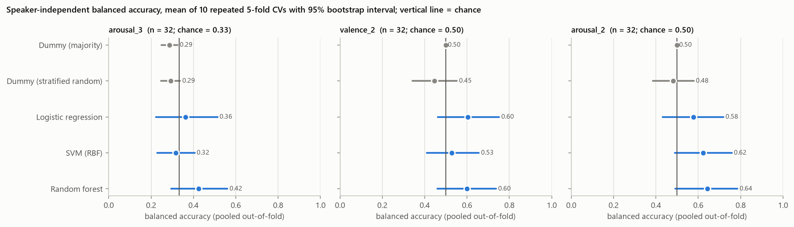
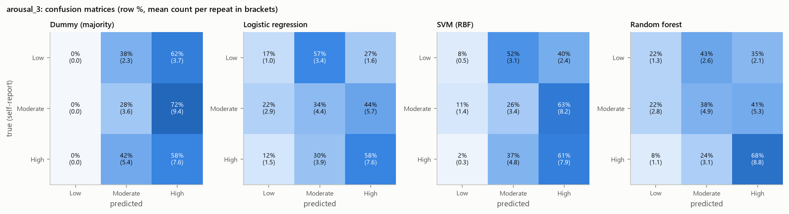
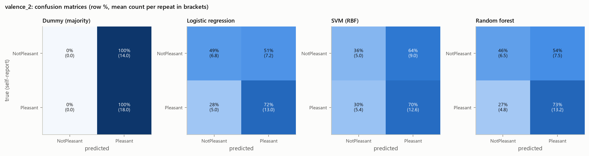
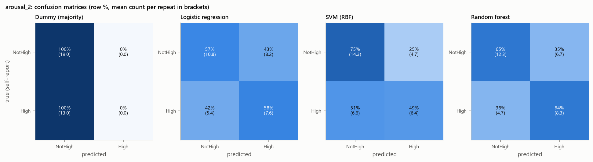

# Bisaya Post-Class Speech and Affective State Recognition Among Computer Science Students

**Group 3 Research Report: Second-Year Computer Science Students (pilot study)**

*Generated by `src/09_build_final_report.py` on 2026-10-03 from the outputs of the project pipeline. Every number in this report is read from a generated data file.*

## Abstract

This pilot study tested whether acoustic and prosodic features of a single, naturally spoken Bisaya word, recorded immediately after class, carry information about the speaker's independently self-reported valence and arousal.

Of 40 second-year CS participants in the Group 3 metadata, 32 had a usable recording. That is below the protocol minimum of 40.

From each recording's automatically located target utterance, 108 features were extracted (F0, energy, zero-crossing rate, MFCC with derivatives, spectral and temporal descriptors). Logistic regression, an RBF support-vector machine and a random forest were compared with dummy baselines under repeated, nested, participant-grouped cross-validation.

No learned model exceeded the label-permutation null after Holm correction (all adjusted p ≥ 0.05; smallest unadjusted p = 0.0240, before correcting for 9 tests). Before correction, 3 of 9 tests had p < 0.05 (Random forest on valence_2: p = 0.030; SVM (RBF) on arousal_2: p = 0.024; Random forest on arousal_2: p = 0.032). If no model carried any signal, about 0.45 such results would be expected by chance across these tests, and none survives the correction. Self-reported valence and arousal were strongly correlated (Spearman ρ = 0.77). Feature–affect correlations surviving FDR correction: 0 of 108 for valence, 3 for arousal.

A recording-configuration artefact affected 20 features, and the retained retakes and automatic utterance localisation add further uncertainty. Within this pilot dataset, the results do not support a claim that the system can recognise post-class affect from speech. The findings should be interpreted as a feasibility study.

## 1. Introduction

Speech Emotion Recognition (SER) research has largely relied on acted emotion. This project instead studies *naturally expressed* post-class affect in Computer Science students. Each participant says one Bisaya word of their choosing and then reports how they actually feel. The self-report, not the meaning of the word and not a listener's impression, is the reference label ("Kapoy" ≠ automatically sad).

The computational question is whether *how* the word is spoken (its acoustic and prosodic realisation) contains information about that self-reported state.

## 2. Research Objectives

1. Determine the affective states reported by CS students immediately after class.
2. Examine the acoustic and prosodic characteristics of short Bisaya post-class responses.
3. Investigate whether acoustic/prosodic features can classify self-reported affective states.
4. Compare appropriate machine learning models for Bisaya affect recognition.
5. Explore relationships between post-class affect and educational context (class activity, year level, session).

## 3. Research Questions

| RQ | Question (protocol) | Addressed in Group 3 |
|---|---|---|
| RQ1 | What affective states do students report immediately after class? | §7.1 |
| RQ2 | How does affect vary by year level, class activity and session? | **Not answerable within Group 3**: all three are constant (§7.3); requires the consolidated class dataset |
| RQ3 | Which acoustic/prosodic characteristics accompany different self-reported states? | §7.2 |
| RQ4 | To what extent can ML classify self-reported affect from acoustic features? | §8 |
| RQ5 | Which model performs best? | §8.3 |

## 4. Methodology

### 4.1 Participants

The assigned population is Second-Year CS students (protocol §IV). The Group 3 metadata lists 40 participants, Y2-041 to Y2-080, every one recorded as 2nd year. Recordings were supplied for 32 of them. No recording exists for 8 (Y2-053, Y2-071, Y2-074, Y2-076, Y2-077, Y2-078, Y2-079, Y2-080). The analysis set comprises the **32 participants** with a usable recording and valid ratings. Every participant contributes exactly one observation.

### 4.2 Research Ethics

The metadata records informed consent ('Yes') for all 40 participants. **No consent documentation (forms, consent log or institutional clearance) was supplied** to the analysts. Protocol §VI makes it a requirement before the data can be used for publication, so the results in this report must not be disseminated until it is verified.

Participants are identified only by pseudonymous codes. The raw videos (faces, possible GPS tags) are kept locally and never copied into the analysis. Only audio is processed, and location metadata is never extracted.

### 4.3 Data Collection

Every metadata row records Class Activity 'Lecture' and Session 'Afternoon–Evening' (subject: Environmental Science for 30 rows, blank for 10).

Embedded capture times place 27 of the 32 selected recordings between 18:09 and 18:55 (PHT) on 2026-10-01. That is consistent with the recorded session. The time boundary between sessions was not documented in the supplied material.

All recordings were made on one smartphone model (iPhone 17) as short MOV videos (AAC, 48 kHz). 6 recordings differ in audio configuration (stereo plus a second track); 5 of them were captured 8.9–9.1 h after the median capture time. The group must explain this (see §6).

### 4.4 Natural Bisaya Speech Procedure

Participants were asked to choose one word closest to their reaction and say it naturally. The protocol lists Salamat, Ambot, Grabe, Lisod, Sayon, Lingaw and Kapoy.

In Group 3, 15 of 31 recorded words are on that list (Kapoy, Salamat, Lingaw) and 16 are not (most frequent: Nalipay, Katulgon, Gutom, Nalingaw). 9 rows have no recorded word. Whether off-list words are acceptable needs an instructor ruling. They are kept here because the word is never a model input.

### 4.5 Self-Reported Affect

Immediately after the recording, each participant described how they felt and rated valence (1 very unpleasant – 5 very pleasant) and arousal (1 very low – 5 very high). These ratings are the reference labels.

Y2-076's arousal rating is struck through in the sheet and is not used. Y2-076 has no recording in any case.

### 4.6 Audio Processing

1. **Original-audio QA:** peak, clipping, DC offset, level and configuration, measured before processing.
2. **Standardisation:** ffmpeg first audio stream → mono → 16 kHz → WAV PCM 16-bit, metadata stripped. There is no filtering, denoising, normalisation, pitch or speed change. Output is byte-reproducible.
3. **Target-utterance localisation.** The clips contain continuous hallway babble and sometimes other speech, so the participant's word was located as the dominant short-time-energy event. This is deterministic and blind to labels. Segments touching the clip edge, longer than 1.5 s, or with a competing event within 3 dB are flagged.
4. **Duplicates.** 5 participants (Y2-044, Y2-047, Y2-056, Y2-057, Y2-064) had retakes captured seconds apart. One take each was chosen by a label-blind *complete-word rule*: drop takes whose word is cut off by the clip edge, too long to be one word, or too short to contain the recorded word (< 0.10 s per syllable); prefer a take without a competing event; then use the clearest take if it is ≥ 3 dB clearer, otherwise the earliest. Takes are never chosen for sounding more emotional. Spectrogram comparisons and a listening packet are provided for the group to confirm.
5. **Naming:** `ParticipantCode_YearLevel_Session_Word.wav`. `PM` is assumed for Afternoon–Evening, and `UNVERIFIED` is used where no word was recorded.

### 4.7 Acoustic Feature Extraction

For each located utterance, 108 features were computed: duration and voicing (3); F0 from Praat autocorrelation pitch (mean, SD, median, minimum, maximum, IQR in Hz; semitone SD, range and slope) (9); RMS energy in dBFS (6); zero-crossing rate (6); 13 MFCCs with Δ and ΔΔ (mean and SD each: 78); spectral centroid, bandwidth and roll-off (6).

Praat was used instead of librosa pYIN, whose voicing decisions were unstable in this noise (see documentation). F0 in Hz mainly reflects voice type, because no speaker baseline exists.

### 4.8 Machine Learning Methods

- **Inputs:** acoustic features only. Spoken word, feeling text, year, subject, session, class activity, participant code and file names are excluded, and the training script refuses to run otherwise.
- **Targets:** derived groupings of the participants' own ratings. A task is modelled only if every class has at least 5 participants. Modelled: arousal_3 (primary), valence_2 (primary), arousal_2 (secondary). Not modelled (too few participants in a class): valence_5, arousal_5, valence_3.
- **Models:** DummyClassifier (majority; stratified), L2 logistic regression, RBF SVM and random forest, each in a Pipeline of median imputation and standardisation (no scaler for the forest).
- **Imbalance:** class weights; no resampling.
- **Tuning:** small grids, tuned only inside training folds.

### 4.9 Evaluation Strategy

- **Cross-validation:** speaker-independent StratifiedGroupKFold grouped by participant (5 folds), repeated 10 times. Every split is verified to share no participant.
- **Metrics:** accuracy, balanced accuracy, macro precision, recall and F1, per-class metrics and confusion matrices.
- **Uncertainty and chance:** a participant-level bootstrap gives 95% intervals. A label-permutation test (500 permutations of the full nested procedure) checks each model against chance, with Holm adjustment.
- **Model comparison:** corrected repeated k-fold t-test (Nadeau & Bengio, 2003).
- **Sensitivity analyses:** removing retake participants, config-B/capture-outlier recordings and segmentation-critical recordings.

## 5. Dataset Description

| Stage | n |
|---|---|
| Metadata rows (participants) | 40 |
| Participants with ≥1 recording | 32 |
| Recording files supplied | 38 |
| Participants with retakes | 5 |
| Participants with a usable selected recording (analysis set) | 32 |
| Protocol minimum | 40 |

Target class counts in the analysis set:

| Task | Classes | Modelled |
|---|---|---|
| valence_5 | 1: 1 / 2: 1 / 3: 12 / 4: 9 / 5: 9 | no |
| arousal_5 | 1: 2 / 2: 4 / 3: 13 / 4: 9 / 5: 4 | no |
| valence_3 | Unpleasant: 2 / Neutral: 12 / Pleasant: 18 | no |
| arousal_3 | Low: 6 / Moderate: 13 / High: 13 | yes |
| valence_2 | NotPleasant: 14 / Pleasant: 18 | yes |
| arousal_2 | NotHigh: 19 / High: 13 | yes |

## 6. Data Quality Results

| Quantity | Value |
|---|---|
| Recordings (files) | 38 |
| Participants without any recording | 8 (Y2-053, Y2-071, Y2-074, Y2-076, Y2-077, Y2-078, Y2-079, Y2-080) |
| Duplicate (retake) participants / extra files | 5 / 6 |
| Unreadable files / files without speech | 0 / 0 |
| Valid recordings (selected, usable) | 32 |
| Selected recordings with ≥1 flag | 30 |
| …with a segmentation-critical flag | 12 |
| …with a different recording configuration | 6 |

Flags among the selected recordings: BACKGROUND_VOICES 27, COMPETING_EVENT 8, RECORDING_CONFIG_DIFFERS 6, LOW_SBR 5, CAPTURE_TIME_OUTLIER 5, LONG_CLIP 4, EDGE_START 3, TOO_SHORT_FOR_WORD 2, LONG_SEGMENT 2. Background voices were detected in 27 of 32 selected clips. The recordings were not made in a quiet place (protocol §X).

**Recording-configuration artefact.** The 6 config-B recordings differ from the rest in 20 of 108 features at FDR q < 0.05 (lower mfcc_1_mean, lower zcr_mean, lower spectral_centroid_hz_mean). This is a device/setting effect that a classifier could mistake for affect. Configuration was not significantly associated with the labels (valence_2: p = 0.36; arousal_2: p = 0.36; arousal_3: p = 0.51).

Full detail: `reports/data_quality_report.md`.

## 7. Exploratory Analysis

### 7.1 Self-reported affect (RQ1)

Valence was mostly neutral to pleasant (analysis set: 1: 1, 2: 1, 3: 12, 4: 9, 5: 9) and arousal mostly moderate to high (1: 2, 2: 4, 3: 13, 4: 9, 5: 4). Only 2 participants in the analysis set reported unpleasant valence (1–2). Valence and arousal were strongly positively correlated (ρ = 0.77, p = 3.3e-07, n = 32): lower valence tended to co-occur with lower arousal.

### 7.2 Acoustic characteristics by self-reported affect (RQ3)

Across 108 features, 3 correlated with arousal and 0 with valence after Benjamini–Hochberg correction. The strongest associations were delta2_mfcc_13_std with arousal (ρ = +0.62, q = 0.013) and rms_db_iqr with valence (ρ = -0.47, q = 0.375).

Among the six pre-specified prosodic features (F0 median, F0 range, RMS level, duration, spectral centroid, voiced ratio), the strongest association with arousal was rms_db_mean (ρ = +0.34, p = 0.054) and with valence rms_db_mean (ρ = +0.39, p = 0.026); none passed FDR correction (see `reports/exploratory_analysis.md`, Fig. 9–10).

### 7.3 Educational context (RQ2)

Year level (2nd year), class activity (Lecture) and session (Afternoon–Evening) are constant across Group 3, and subject is one value or blank. Their relationship with affect **cannot be estimated** from these data; this requires the consolidated class dataset.

## 8. Machine Learning Results

### 8.1 Primary results (RQ4)

| Task | Model | Balanced accuracy [95% CI] | Macro-F1 [95% CI] | Accuracy | Fold BA mean ± SD | Permutation p (Holm) |
|---|---|---|---|---|---|---|
| arousal_3 | Dummy (majority) | 0.287 [0.249, 0.326] | 0.247 [0.209, 0.282] | 0.350 | 0.333 ± 0.000 | — |
| arousal_3 | Dummy (stratified) | 0.292 [0.247, 0.338] | 0.286 [0.234, 0.327] | 0.312 | 0.297 ± 0.213 | — |
| arousal_3 | Logistic regression | 0.363 [0.223, 0.514] | 0.359 [0.212, 0.507] | 0.406 | 0.367 ± 0.195 | 0.283 (1.000) |
| arousal_3 | SVM (RBF) | 0.318 [0.229, 0.406] | 0.289 [0.197, 0.373] | 0.369 | 0.328 ± 0.137 | 0.615 (1.000) |
| arousal_3 | Random forest | 0.424 [0.294, 0.561] | 0.416 [0.279, 0.554] | 0.469 | 0.430 ± 0.173 | 0.146 (0.729) |
| valence_2 | Dummy (majority) | 0.500 [0.500, 0.500] | 0.360 [0.360, 0.360] | 0.562 | 0.500 ± 0.000 | — |
| valence_2 | Dummy (stratified) | 0.445 [0.343, 0.552] | 0.445 [0.338, 0.548] | 0.450 | 0.444 ± 0.223 | — |
| valence_2 | Logistic regression | 0.604 [0.462, 0.752] | 0.603 [0.451, 0.752] | 0.619 | 0.605 ± 0.167 | 0.253 (1.000) |
| valence_2 | SVM (RBF) | 0.529 [0.409, 0.656] | 0.517 [0.386, 0.649] | 0.550 | 0.527 ± 0.127 | 0.621 (1.000) |
| valence_2 | Random forest | 0.599 [0.461, 0.737] | 0.598 [0.446, 0.737] | 0.616 | 0.602 ± 0.175 | 0.030 (0.240) |
| arousal_2 | Dummy (majority) | 0.500 [0.500, 0.500] | 0.373 [0.373, 0.373] | 0.594 | 0.500 ± 0.000 | — |
| arousal_2 | Dummy (stratified) | 0.482 [0.385, 0.579] | 0.481 [0.379, 0.576] | 0.506 | 0.489 ± 0.244 | — |
| arousal_2 | Logistic regression | 0.577 [0.432, 0.719] | 0.569 [0.419, 0.707] | 0.575 | 0.577 ± 0.215 | 0.086 (0.515) |
| arousal_2 | SVM (RBF) | 0.622 [0.490, 0.758] | 0.622 [0.481, 0.757] | 0.647 | 0.627 ± 0.196 | 0.024 (0.216) |
| arousal_2 | Random forest | 0.643 [0.491, 0.785] | 0.637 [0.484, 0.776] | 0.644 | 0.647 ± 0.205 | 0.032 (0.240) |

Balanced accuracy and macro-F1 are computed on pooled out-of-fold predictions and averaged over repeats; the 95% interval is a participant-level stratified bootstrap. Chance balanced accuracy is 1/number of classes.

**No learned model exceeded the label-permutation null after Holm correction (all adjusted p ≥ 0.05; smallest unadjusted p = 0.0240, before correcting for 9 tests). Before correction, 3 of 9 tests had p < 0.05 (Random forest on valence_2: p = 0.030; SVM (RBF) on arousal_2: p = 0.024; Random forest on arousal_2: p = 0.032). If no model carried any signal, about 0.45 such results would be expected by chance across these tests, and none survives the correction.**

### 8.2 Per-class behaviour

| task | model | class | support | precision | recall | f1 |
|---|---|---|---|---|---|---|
| arousal_3 | Logistic regression | Low | 6 | 0.197 | 0.167 | 0.178 |
| arousal_3 | Logistic regression | Moderate | 13 | 0.374 | 0.338 | 0.354 |
| arousal_3 | Logistic regression | High | 13 | 0.514 | 0.585 | 0.544 |
| arousal_3 | SVM (RBF) | Low | 6 | 0.125 | 0.083 | 0.095 |
| arousal_3 | SVM (RBF) | Moderate | 13 | 0.299 | 0.262 | 0.273 |
| arousal_3 | SVM (RBF) | High | 13 | 0.427 | 0.608 | 0.498 |
| arousal_3 | Random forest | Low | 6 | 0.256 | 0.217 | 0.231 |
| arousal_3 | Random forest | Moderate | 13 | 0.465 | 0.377 | 0.415 |
| arousal_3 | Random forest | High | 13 | 0.544 | 0.677 | 0.602 |
| valence_2 | Logistic regression | NotPleasant | 14 | 0.578 | 0.486 | 0.526 |
| valence_2 | Logistic regression | Pleasant | 18 | 0.644 | 0.722 | 0.680 |
| valence_2 | SVM (RBF) | NotPleasant | 14 | 0.480 | 0.357 | 0.400 |
| valence_2 | SVM (RBF) | Pleasant | 18 | 0.586 | 0.700 | 0.634 |
| valence_2 | Random forest | NotPleasant | 14 | 0.577 | 0.464 | 0.513 |
| valence_2 | Random forest | Pleasant | 18 | 0.638 | 0.733 | 0.682 |
| arousal_2 | Logistic regression | NotHigh | 19 | 0.667 | 0.568 | 0.612 |
| arousal_2 | Logistic regression | High | 13 | 0.482 | 0.585 | 0.526 |
| arousal_2 | SVM (RBF) | NotHigh | 19 | 0.685 | 0.753 | 0.716 |
| arousal_2 | SVM (RBF) | High | 13 | 0.581 | 0.492 | 0.529 |
| arousal_2 | Random forest | NotHigh | 19 | 0.725 | 0.647 | 0.683 |
| arousal_2 | Random forest | High | 13 | 0.553 | 0.638 | 0.592 |

### 8.3 Model comparison (RQ5)

No pair of learned models differed significantly on any task (corrected repeated k-fold t-test, all p ≥ 0.05). The data therefore do not identify a best model; the highest point estimates were arousal_2: Random forest 0.643 (chance 0.50); valence_2: Logistic regression 0.604 (chance 0.50); arousal_3: Random forest 0.424 (chance 0.33).

| task | model_a | model_b | mean_ba_difference | corrected_t | p_value |
|---|---|---|---|---|---|
| arousal_3 | Logistic regression | SVM (RBF) | 0.039 | 0.471 | 0.640 |
| arousal_3 | Logistic regression | Random forest | -0.063 | -1.091 | 0.280 |
| arousal_3 | SVM (RBF) | Random forest | -0.102 | -1.415 | 0.163 |
| arousal_3 | Logistic regression | Dummy (majority) | 0.033 | 0.328 | 0.744 |
| arousal_3 | SVM (RBF) | Dummy (majority) | -0.006 | -0.078 | 0.938 |
| arousal_3 | Random forest | Dummy (majority) | 0.097 | 1.077 | 0.287 |
| valence_2 | Logistic regression | SVM (RBF) | 0.078 | 0.942 | 0.351 |
| valence_2 | Logistic regression | Random forest | 0.002 | 0.037 | 0.971 |
| valence_2 | SVM (RBF) | Random forest | -0.076 | -0.913 | 0.366 |
| valence_2 | Logistic regression | Dummy (majority) | 0.105 | 1.214 | 0.231 |
| valence_2 | SVM (RBF) | Dummy (majority) | 0.027 | 0.404 | 0.688 |
| valence_2 | Random forest | Dummy (majority) | 0.102 | 1.126 | 0.266 |
| arousal_2 | Logistic regression | SVM (RBF) | -0.049 | -0.634 | 0.529 |
| arousal_2 | Logistic regression | Random forest | -0.069 | -0.912 | 0.366 |
| arousal_2 | SVM (RBF) | Random forest | -0.020 | -0.233 | 0.817 |
| arousal_2 | Logistic regression | Dummy (majority) | 0.077 | 0.694 | 0.491 |
| arousal_2 | SVM (RBF) | Dummy (majority) | 0.127 | 1.244 | 0.219 |
| arousal_2 | Random forest | Dummy (majority) | 0.147 | 1.377 | 0.175 |

### 8.4 Sensitivity analyses

| scenario | task | model | n | BA (subset) | BA (all 32) | difference |
|---|---|---|---|---|---|---|
| high_confidence_segmentation | arousal_3 | Dummy (majority) | 20 | 0.333 | 0.287 | 0.046 |
| high_confidence_segmentation | arousal_3 | Dummy (stratified) | 20 | 0.335 | 0.292 | 0.042 |
| high_confidence_segmentation | arousal_3 | Logistic regression | 20 | 0.381 | 0.363 | 0.017 |
| high_confidence_segmentation | arousal_3 | Random forest | 20 | 0.367 | 0.424 | -0.057 |
| high_confidence_segmentation | arousal_3 | SVM (RBF) | 20 | 0.224 | 0.318 | -0.094 |
| high_confidence_segmentation | valence_2 | Dummy (majority) | 20 | 0.500 | 0.500 | 0.000 |
| high_confidence_segmentation | valence_2 | Dummy (stratified) | 20 | 0.444 | 0.445 | -0.001 |
| high_confidence_segmentation | valence_2 | Logistic regression | 20 | 0.545 | 0.604 | -0.059 |
| high_confidence_segmentation | valence_2 | Random forest | 20 | 0.522 | 0.599 | -0.077 |
| high_confidence_segmentation | valence_2 | SVM (RBF) | 20 | 0.503 | 0.529 | -0.026 |
| no_config_B | valence_2 | Dummy (majority) | 26 | 0.500 | 0.500 | 0.000 |
| no_config_B | valence_2 | Dummy (stratified) | 26 | 0.382 | 0.445 | -0.063 |
| no_config_B | valence_2 | Logistic regression | 26 | 0.503 | 0.604 | -0.101 |
| no_config_B | valence_2 | Random forest | 26 | 0.569 | 0.599 | -0.029 |
| no_config_B | valence_2 | SVM (RBF) | 26 | 0.524 | 0.529 | -0.005 |
| no_retakes | arousal_3 | Dummy (majority) | 27 | 0.333 | 0.287 | 0.046 |
| no_retakes | arousal_3 | Dummy (stratified) | 27 | 0.327 | 0.292 | 0.035 |
| no_retakes | arousal_3 | Logistic regression | 27 | 0.396 | 0.363 | 0.032 |
| no_retakes | arousal_3 | Random forest | 27 | 0.435 | 0.424 | 0.011 |
| no_retakes | arousal_3 | SVM (RBF) | 27 | 0.361 | 0.318 | 0.044 |
| no_retakes | valence_2 | Dummy (majority) | 27 | 0.440 | 0.500 | -0.060 |
| no_retakes | valence_2 | Dummy (stratified) | 27 | 0.454 | 0.445 | 0.009 |
| no_retakes | valence_2 | Logistic regression | 27 | 0.574 | 0.604 | -0.030 |
| no_retakes | valence_2 | Random forest | 27 | 0.609 | 0.599 | 0.010 |
| no_retakes | valence_2 | SVM (RBF) | 27 | 0.529 | 0.529 | 0.000 |

Not modelled under the viability rule (class counts after removal): no_config_B/arousal_3 (Low: 4, Moderate: 10, High: 12). Full detail: `reports/model_evaluation.md`.

## 9. Lexically Controlled Analysis

Only *Kapoy* had enough recordings (10) and rating variation for a same-word comparison. Within *Kapoy*, 0 of 12 feature–rating correlations passed FDR correction. Within-word correlations had the same sign as in the full sample in 67% of tests. With n = 10 (7 report valence 3, 6 report arousal 3), these estimates are descriptive only.

The lexical-confound probe separated *Kapoy* from other words with balanced accuracy 0.755 (permutation p = 0.022); the acoustic features therefore carry word identity. Word choice was associated with the ratings (valence_2: p = 0.006, Cramér's V = 0.53; arousal_3: p = 0.048, Cramér's V = 0.46).

Out-of-fold accuracy of the affect models, averaged over the three learned models: arousal_2: 0.80 for Kapoy vs 0.55 for other words; arousal_3: 0.36 for Kapoy vs 0.46 for other words; valence_2: 0.62 for Kapoy vs 0.60 for other words.

Some full-sample associations change sign once the word is held constant (rms_db_mean with valence: ρ = +0.39 in the full sample but -0.35 within Kapoy; rms_db_mean with arousal: ρ = +0.34 in the full sample but -0.28 within Kapoy). Those associations are therefore at least partly lexical.

**Consequence.** Both conditions for a lexical confound hold in these data: the acoustic features identify the word, and the word is associated with the self-reports. Any above-chance affect classification here can therefore reflect *which word* was said rather than *how* it was said. Only the within-word comparison controls for this, and it found no reliable effect.

Full detail: `reports/lexical_control_analysis.md`.

## 10. Discussion

**Observations.**
- 32 of 40 participants have usable recordings; there are 5 retake sets, 9 missing words, and a different recording configuration for 6 files.
- The recordings are short clips in a noisy, multi-speaker environment.
- Self-reports cluster at neutral-to-pleasant valence (3–5: 30 of 32) and moderate-to-high arousal (3–5: 26 of 32).

**Statistical results.**
- Valence and arousal co-vary strongly (ρ = 0.77).
- After FDR correction, 3 feature is associated with arousal and 0 with valence.
- The recording configuration changes 20 features.

**Model performance.**
- No learned model exceeded the label-permutation null after Holm correction (all adjusted p ≥ 0.05; smallest unadjusted p = 0.0240, before correcting for 9 tests). Before correction, 3 of 9 tests had p < 0.05 (Random forest on valence_2: p = 0.030; SVM (RBF) on arousal_2: p = 0.024; Random forest on arousal_2: p = 0.032). If no model carried any signal, about 0.45 such results would be expected by chance across these tests, and none survives the correction.
- Highest point estimates: arousal_2: Random forest 0.643 (chance 0.50); valence_2: Logistic regression 0.604 (chance 0.50); arousal_3: Random forest 0.424 (chance 0.33).
- Bootstrap intervals are wide and overlap chance-level baselines.

**Interpretation.**
- Within this pilot dataset, the evidence that the speech signal of a single word predicts an unseen student's self-reported affect is weak at best.
- Three factors plausibly limit any signal:
  1. a small, label-sparse sample (very few unpleasant or low-arousal reports);
  2. heavy background babble and automatic utterance localisation;
  3. single-word utterances that give little prosodic material.
- The lexical confound is not hypothetical here. Acoustic features identify the word (probe balanced accuracy 0.75), word choice is associated with the self-reports, and for arousal_2 the models are markedly more accurate on *Kapoy* recordings (0.80 vs 0.55). An acoustic model can therefore score above chance by recognising the word rather than affective prosody.
- Recording configuration is a further confound: 6 recordings differ systematically in 20 acoustic features.
- These are associations in a small observational sample. Nothing here shows that classes, activities or words *cause* any affective state.
- A negative or null result at this sample size is informative for the class study: it argues for the consolidated dataset, quieter recording, and verified segmentation.

## 11. Limitations

1. **Small sample, below the protocol minimum:** n = 32 < 40; no participant recording for Y2-053, Y2-071, Y2-074, Y2-076, Y2-077, Y2-078, Y2-079, Y2-080.
2. **Class imbalance and sparse categories:** unpleasant valence n = 2; valence_5, arousal_5, valence_3 could not be modelled; derived groupings merge categories.
3. **Single-word utterances** (0.23–2.87 s located segments) carry limited prosodic information.
4. **Naturally occurring noise:** background voices detected in 27 of 32 selected clips; low utterance-to-background ratio (< 10 dB) in 5.
5. **Automatic segmentation, not verified by listening**; 12 recordings have segmentation-critical flags.
6. **Device/setting variability:** 6 recordings with a different audio configuration shift 20 features. F0 in Hz is dominated by voice type (no speaker baseline).
7. **Limited contextual variation:** one year level, one activity, one session; RQ2 is not answerable within Group 3.
8. **Possible lexical influence:** 16 of 31 words are off the protocol list and words differ phonetically, so acoustic features can encode word identity.
9. **Self-report uncertainty:** single-item ratings; 16 rows with feeling text identical to the word; 2 rows without a description; 1 struck-through rating.
10. **Duplicates and missing observations:** 5 retake sets were resolved by the complete-word rule, pending listening confirmation; 8 participants have no recording.
11. **No demographic variables were collected** (the protocol allows optional variables only when approved), so speaker characteristics such as sex confound F0.
12. **Consent documentation not supplied;** dissemination is blocked until it is verified.
13. **Limited generalisability:** one class session, one device model; a pilot study.

## 12. Conclusion

The Group 3 pipeline is complete and reproducible: data audit, metadata cleaning, audio standardisation and quality control, feature extraction, exploratory analysis, speaker-independent machine learning, evaluation, lexical control and validation. It produced a documented dataset of 32 observations.

No learned model exceeded the label-permutation null after Holm correction (all adjusted p ≥ 0.05; smallest unadjusted p = 0.0240, before correcting for 9 tests). Before correction, 3 of 9 tests had p < 0.05 (Random forest on valence_2: p = 0.030; SVM (RBF) on arousal_2: p = 0.024; Random forest on arousal_2: p = 0.032). If no model carried any signal, about 0.45 such results would be expected by chance across these tests, and none survives the correction. Within this pilot dataset, the results therefore do not support a claim that the system can recognise post-class affect from speech.

They do identify concrete requirements for the consolidated study: reach the planned sample, record in a quieter location with one consistent device setting, verify the target utterance by listening, collect more low-valence and low-arousal responses, and supply consent documentation.

## 13. References

- Benjamini, Y., & Hochberg, Y. (1995). Controlling the false discovery rate: A practical and powerful approach to multiple testing. *Journal of the Royal Statistical Society: Series B, 57*(1), 289–300.
- Boersma, P. (1993). Accurate short-term analysis of the fundamental frequency and the harmonics-to-noise ratio of a sampled sound. *Proceedings of the Institute of Phonetic Sciences, 17*, 97–110.
- Bouckaert, R. R., & Frank, E. (2004). Evaluating the replicability of significance tests for comparing learning algorithms. In *Advances in Knowledge Discovery and Data Mining (PAKDD 2004)*, LNCS 3056, 3–12.
- CS412 Research Mini-Project (v2). *Bisaya Post-Class Speech and Affective State Recognition Among Computer Science Students* (course protocol).
- Holm, S. (1979). A simple sequentially rejective multiple test procedure. *Scandinavian Journal of Statistics, 6*(2), 65–70.
- Jadoul, Y., Thompson, B., & de Boer, B. (2018). Introducing Parselmouth: A Python interface to Praat. *Journal of Phonetics, 71*, 1–15.
- McFee, B., Raffel, C., Liang, D., Ellis, D. P. W., McVicar, M., Battenberg, E., & Nieto, O. (2015). librosa: Audio and music signal analysis in Python. *Proceedings of the 14th Python in Science Conference*, 18–25.
- Nadeau, C., & Bengio, Y. (2003). Inference for the generalization error. *Machine Learning, 52*(3), 239–281.
- Ojala, M., & Garriga, G. C. (2010). Permutation tests for studying classifier performance. *Journal of Machine Learning Research, 11*, 1833–1863.
- Pedregosa, F., et al. (2011). Scikit-learn: Machine learning in Python. *Journal of Machine Learning Research, 12*, 2825–2830.
- Russell, J. A. (1980). A circumplex model of affect. *Journal of Personality and Social Psychology, 39*(6), 1161–1178.

## 14. Appendices

### A. Expected research outputs (Protocol §XVIII): status matrix

| Deliverable | Status | File | Evidence | Remaining issue |
|---|---|---|---|---|
| 1. Minimum of 40 valid participant observations | BLOCKED | data/analysis_manifest.csv | 32 valid unique participants; 8 metadata participants have no recording | needs 8 more valid observations: recordings for Y2-053, Y2-071, Y2-074, Y2-076, Y2-077, Y2-078, Y2-079, Y2-080 (if they exist) or new consented participants |
| 2. Required consent documentation | BLOCKED | consent/ | sheet records consent 'Y' for 40/40; 0 documentation files supplied | supply a de-identified consent log and ethics/data-privacy clearance; keep signed forms outside the dataset |
| 3. Properly coded research metadata | COMPLETE | data/metadata_cleaned.csv, reports/phase1/cleaning_log.csv | 40 rows; raw kept beside cleaned; 244 logged changes (rules R1–R8) | confirm: Y2-076 arousal; 'Lecture' → 'Lecture/Discussion'; off-list words; 9 missing words, 2 missing feelings |
| 4. Properly named audio recordings | COMPLETE | data/processed_audio/recordings/, file_mapping.csv | 32 WAVs named ParticipantCode_YearLevel_Session_Word.wav; mapping for all 38 originals | Y2-073 word token UNVERIFIED (word not recorded); session token PM is an assumption |
| 5. Data quality report | COMPLETE | reports/data_quality_report.md | 38 recordings assessed; 30 selected takes with ≥1 flag | segment boundaries await listening review |
| 6. Extracted acoustic feature dataset | COMPLETE | data/acoustic_features.csv | 32 × 108 features, no missing values | — |
| 7. Exploratory analysis | COMPLETE | reports/exploratory_analysis.md | affect distributions, feature–affect statistics, confound analysis | context × affect (RQ2) not analysable within Group 3 (constant variables) |
| 8. Machine learning experiment | COMPLETE | models/, src/06_train_models.py | 3 viable tasks × 5 models, 10× repeated nested speaker-independent CV | tasks not modelled (sparse classes): valence_5, arousal_5, valence_3 |
| 9. Model evaluation | COMPLETE | reports/model_evaluation.md | BA, macro-P/R/F1, accuracy, per-class, confusion matrices, bootstrap CIs, permutation tests, corrected t-tests | — |
| 10. Interpretation of findings | COMPLETE | this report, §10 | observations / statistics / performance / interpretation separated | — |
| 11. Research limitations | COMPLETE | this report, §11 | sample, noise, device, lexical, self-report, duplicates, ethics | — |
| 12. Group research report | COMPLETE | reports/final_group_research_report.md | generated from the pipeline outputs | dissemination blocked until consent documentation is verified (item 2) |

### B. Validation

Automated checks of the whole project (raw files preserved, WAV format and naming, one feature row per participant, no leakage, speaker independence, report–result consistency) are in `reports/validation_report.md`.

### C. Decisions awaiting confirmation

See `docs/decision_log.md` (items marked PENDING):
- the retake choices;
- the config-B recordings;
- Y2-076's arousal;
- off-list words;
- 'Lecture' → 'Lecture/Discussion';
- the `PM` token;
- consent documentation;
- listening verification of utterance boundaries and of Y2-073's word.

### D. Reproduction

`.venv/Scripts/python.exe run_pipeline.py` (see `README.md` and `docs/DOCUMENTATION.md`).
