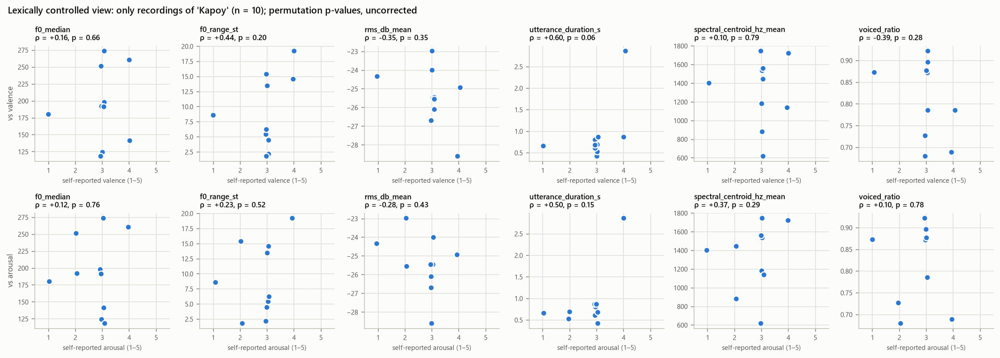

# Lexically Controlled Analysis (Phase 13, Protocol §XVII)

*Generated by `src/08_lexical_control.py`. The spoken word is used only to **select** recordings; it is never a predictor. Tables: `reports/lexical/`.*

## A. Which words allow a within-word comparison?

| spoken_word | n | valence_distinct | arousal_distinct | valence_values | arousal_values | eligible |
|---|---|---|---|---|---|---|
| Kapoy | 10 | 3 | 4 | 1, 3, 3, 3, 3, 3, 3, 3, 4, 4 | 1, 2, 2, 3, 3, 3, 3, 3, 3, 4 | True |
| Salamat | 3 | 2 | 1 | 4, 5, 5 | 4, 4, 4 | False |
| Nalipay | 3 | 2 | 1 | 4, 5, 5 | 5, 5, 5 | False |
| Katulgon | 2 | 1 | 2 | 3, 3 | 2, 3 | False |
| Lingaw | 2 | 2 | 1 | 3, 5 | 4, 4 | False |
| Gutom | 2 | 2 | 1 | 3, 4 | 3, 3 | False |
| Nalingaw | 2 | 2 | 2 | 4, 5 | 3, 5 | False |
| Hangak | 1 | 1 | 1 | 3 | 2 | False |
| Liboga | 1 | 1 | 1 | 5 | 3 | False |
| Lipay | 1 | 1 | 1 | 4 | 4 | False |
| Milamdag | 1 | 1 | 1 | 5 | 4 | False |
| Malipay | 1 | 1 | 1 | 5 | 4 | False |
| Maayo | 1 | 1 | 1 | 4 | 3 | False |
| Okay | 1 | 1 | 1 | 4 | 3 | False |

A word is eligible when it has ≥ 8 recordings and variation in at least one rating. **Eligible: Kapoy.** No other word has more than 3 recordings, so the protocol's example comparison (for example 'Grabe' + positive vs 'Grabe' + negative) is possible only for *Kapoy*, and only descriptively.

## B. Same word, different self-reported affect

Spearman correlation between the six pre-specified prosodic features and the ratings, inside each eligible word. Permutation p-values (20,000 permutations), Benjamini–Hochberg across the 12 tests. **0 of 12 pass q < 0.05.** In 67% of tests the within-word correlation has the same sign as in the full sample.

| word | n | rating | feature | rho_within_word | p_perm | rho_full_sample | same_direction | q_bh |
|---|---|---|---|---|---|---|---|---|
| Kapoy | 10 | valence | f0_median | 0.157 | 0.656 | 0.150 | True | 0.789 |
| Kapoy | 10 | valence | f0_range_st | 0.442 | 0.199 | 0.132 | True | 0.691 |
| Kapoy | 10 | valence | rms_db_mean | -0.352 | 0.345 | 0.393 | False | 0.691 |
| Kapoy | 10 | valence | utterance_duration_s | 0.597 | 0.063 | 0.068 | True | 0.691 |
| Kapoy | 10 | valence | spectral_centroid_hz_mean | 0.097 | 0.789 | 0.105 | True | 0.789 |
| Kapoy | 10 | valence | voiced_ratio | -0.394 | 0.280 | 0.111 | False | 0.691 |
| Kapoy | 10 | arousal | f0_median | 0.117 | 0.756 | 0.113 | True | 0.789 |
| Kapoy | 10 | arousal | f0_range_st | 0.233 | 0.523 | 0.129 | True | 0.785 |
| Kapoy | 10 | arousal | rms_db_mean | -0.281 | 0.433 | 0.344 | False | 0.742 |
| Kapoy | 10 | arousal | utterance_duration_s | 0.495 | 0.150 | 0.092 | True | 0.691 |
| Kapoy | 10 | arousal | spectral_centroid_hz_mean | 0.370 | 0.294 | 0.255 | True | 0.691 |
| Kapoy | 10 | arousal | voiced_ratio | 0.103 | 0.779 | -0.080 | False | 0.789 |

Within *Kapoy* (n = 10): 7 of 10 report valence 3 and 6 report arousal 3. One or two participants at the extremes can therefore determine a correlation. These estimates are descriptive only.

## C. Does the acoustic signal carry the word's identity? (lexical-confound probe)

Same leakage-safe pipeline (median imputation, standardisation, L2 logistic regression; participant-grouped stratified 5-fold CV, 10 repeats) predicting *Kapoy* vs any other word from the acoustic features alone (n = 31: 10 Kapoy, 21 other).

| balanced accuracy (mean of 10 repeats) | range over repeats | permutation null mean | null 95th percentile | permutation p |
|---|---|---|---|---|
| 0.755 | 0.705–0.829 | 0.502 | 0.681 | 0.022 |

## D. Is word choice itself associated with the ratings?

| target | test | p_value | Cramér's V | counts |
|---|---|---|---|---|
| valence_2 | Fisher exact | 0.006 | 0.532 | Kapoy: {'NotPleasant': 8, 'Pleasant': 2}; other: {'NotPleasant': 5, 'Pleasant': 16} |
| arousal_3 | permutation chi-square (20,000) | 0.048 | 0.458 | Kapoy: {'High': 1, 'Low': 3, 'Moderate': 6}; other: {'High': 12, 'Low': 2, 'Moderate': 7} |

Out-of-fold accuracy of the affect models by word group (all repeats pooled):

| task | model | word_group | participants | accuracy_over_repeats |
|---|---|---|---|---|
| arousal_2 | logistic_regression | Kapoy | 10 | 0.790 |
| arousal_2 | logistic_regression | other words | 21 | 0.495 |
| arousal_2 | logistic_regression | word unknown | 1 | 0.100 |
| arousal_2 | random_forest | Kapoy | 10 | 0.820 |
| arousal_2 | random_forest | other words | 21 | 0.590 |
| arousal_2 | random_forest | word unknown | 1 | 0.000 |
| arousal_2 | svm_rbf | Kapoy | 10 | 0.790 |
| arousal_2 | svm_rbf | other words | 21 | 0.562 |
| arousal_2 | svm_rbf | word unknown | 1 | 1.000 |
| arousal_3 | logistic_regression | Kapoy | 10 | 0.360 |
| arousal_3 | logistic_regression | other words | 21 | 0.448 |
| arousal_3 | logistic_regression | word unknown | 1 | 0.000 |
| arousal_3 | random_forest | Kapoy | 10 | 0.460 |
| arousal_3 | random_forest | other words | 21 | 0.495 |
| arousal_3 | random_forest | word unknown | 1 | 0.000 |
| arousal_3 | svm_rbf | Kapoy | 10 | 0.260 |
| arousal_3 | svm_rbf | other words | 21 | 0.433 |
| arousal_3 | svm_rbf | word unknown | 1 | 0.100 |
| valence_2 | logistic_regression | Kapoy | 10 | 0.630 |
| valence_2 | logistic_regression | other words | 21 | 0.614 |
| valence_2 | logistic_regression | word unknown | 1 | 0.600 |
| valence_2 | random_forest | Kapoy | 10 | 0.670 |
| valence_2 | random_forest | other words | 21 | 0.619 |
| valence_2 | random_forest | word unknown | 1 | 0.000 |
| valence_2 | svm_rbf | Kapoy | 10 | 0.570 |
| valence_2 | svm_rbf | other words | 21 | 0.567 |
| valence_2 | svm_rbf | word unknown | 1 | 0.000 |

## Interpretation rules applied

- If the probe in C separates *Kapoy* from other words above chance, **and** word choice in D is associated with the ratings, an "acoustic-only" affect model can partly learn word identity instead of affective prosody. The protocol (§XV) warns of exactly this risk.
- Only within-word comparisons (B) hold lexical content constant. With a single eligible word and n ≈ 10, they can show the direction of an effect at best, not establish one.
