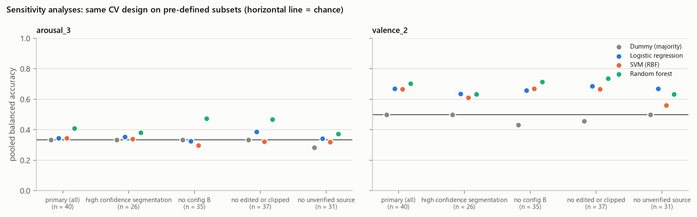

# Model Evaluation (Phases 8–12)

*Generated by `src/07_evaluate_models.py` from `models/` outputs of `src/06_train_models.py` (scikit-learn 1.9.1, random_state 42). Tables: `reports/evaluation/`.*

## 1. Design

- **Input (X):** the 108 acoustic/prosodic features only (`data/acoustic_features.csv`). The training script refuses to run if any metadata column (spoken word, feeling text, year, subject, session, activity, participant code, file name) is in X.
- **Target (y):** derived classes of the participants' own 1–5 ratings (Phase 8; original ratings kept).
- **Speaker-independent evaluation:** StratifiedGroupKFold grouped by participant, 10 repeats with different shuffles. Every split is verified to share no participant between training and test, and every test fold contains every class.
- **No leakage:** median imputation and standardisation are Pipeline steps fitted on training folds only. Hyperparameters are tuned by GridSearchCV on an inner grouped CV inside each outer training fold. There is no resampling and no synthetic data; class imbalance is handled with `class_weight='balanced'`.
- **Grids (deliberately small):** {"dummy_majority": {}, "dummy_stratified": {}, "logistic_regression": {"clf__C": [0.01, 0.1, 1.0, 10.0]}, "svm_rbf": {"clf__C": [0.1, 1.0, 10.0]}, "random_forest": {"clf__min_samples_leaf": [1, 3]}}.
- **Chance:** two DummyClassifiers under the identical CV, plus a label-permutation test (500 permutations, full nested procedure repeated on permuted labels; statistic: pooled out-of-fold balanced accuracy of repeat 0). p-values are Holm-adjusted over all 9 model-vs-chance tests.

## 2. Targets

| task | role | n | classes | modelled | reason / outer folds |
|---|---|---|---|---|---|
| valence_5 | attempted | 40 | 1: 1; 2: 2; 3: 17; 4: 11; 5: 9 | no | smallest class has 1 < 5 participants |
| arousal_5 | attempted | 40 | 1: 3; 2: 6; 3: 15; 4: 12; 5: 4 | no | smallest class has 3 < 5 participants |
| valence_3 | attempted | 40 | Unpleasant: 3; Neutral: 17; Pleasant: 20 | no | smallest class has 3 < 5 participants |
| arousal_3 | primary | 40 | Low: 9; Moderate: 15; High: 16 | yes | 5 |
| valence_2 | primary | 40 | NotPleasant: 20; Pleasant: 20 | yes | 5 |
| arousal_2 | secondary | 40 | NotHigh: 24; High: 16 | yes | 5 |

Not modelled: **valence_5, arousal_5, valence_3**. Each has at least one class with fewer than 5 participants, so stratified test folds and per-class metrics would be meaningless. This is reported rather than forced (Phase 8).

## 3. Results

| task | model | BA pooled [95% CI] | macro-F1 pooled [95% CI] | accuracy pooled | BA folds mean ± SD (min–max) | perm. p | perm. p (Holm) |
|---|---|---|---|---|---|---|---|
| arousal_3 | Dummy (majority) | 0.333 [0.333, 0.333] | 0.190 [0.190, 0.190] | 0.400 | 0.333 ± 0.000 (0.33–0.33) | — | — |
| arousal_3 | Dummy (stratified random) | 0.329 [0.259, 0.409] | 0.313 [0.242, 0.383] | 0.332 | 0.321 ± 0.138 (0.00–0.61) | — | — |
| arousal_3 | Logistic regression | 0.344 [0.226, 0.470] | 0.343 [0.216, 0.468] | 0.363 | 0.339 ± 0.150 (0.00–0.69) | 0.503 | 1.000 |
| arousal_3 | SVM (RBF) | 0.346 [0.259, 0.440] | 0.323 [0.236, 0.409] | 0.335 | 0.332 ± 0.117 (0.11–0.78) | 0.707 | 1.000 |
| arousal_3 | Random forest | 0.410 [0.289, 0.541] | 0.410 [0.284, 0.539] | 0.422 | 0.417 ± 0.150 (0.00–0.72) | 0.134 | 0.802 |
| valence_2 | Dummy (majority) | 0.500 [0.500, 0.500] | 0.333 [0.333, 0.333] | 0.500 | 0.500 ± 0.000 (0.50–0.50) | — | — |
| valence_2 | Dummy (stratified random) | 0.485 [0.388, 0.580] | 0.485 [0.383, 0.577] | 0.485 | 0.485 ± 0.163 (0.25–0.75) | — | — |
| valence_2 | Logistic regression | 0.670 [0.545, 0.785] | 0.668 [0.541, 0.783] | 0.670 | 0.670 ± 0.167 (0.25–1.00) | 0.076 | 0.607 |
| valence_2 | SVM (RBF) | 0.668 [0.545, 0.785] | 0.667 [0.543, 0.783] | 0.668 | 0.667 ± 0.178 (0.25–1.00) | 0.084 | 0.607 |
| valence_2 | Random forest | 0.703 [0.580, 0.815] | 0.702 [0.578, 0.814] | 0.703 | 0.703 ± 0.169 (0.25–1.00) | 0.006 | 0.054 |
| arousal_2 | Dummy (majority) | 0.500 [0.500, 0.500] | 0.375 [0.375, 0.375] | 0.600 | 0.500 ± 0.000 (0.50–0.50) | — | — |
| arousal_2 | Dummy (stratified random) | 0.464 [0.380, 0.550] | 0.462 [0.377, 0.545] | 0.470 | 0.468 ± 0.236 (0.10–0.90) | — | — |
| arousal_2 | Logistic regression | 0.479 [0.360, 0.602] | 0.473 [0.353, 0.590] | 0.480 | 0.480 ± 0.165 (0.17–0.80) | 0.838 | 1.000 |
| arousal_2 | SVM (RBF) | 0.456 [0.361, 0.557] | 0.448 [0.352, 0.542] | 0.468 | 0.472 ± 0.132 (0.10–0.83) | 0.741 | 1.000 |
| arousal_2 | Random forest | 0.554 [0.432, 0.683] | 0.554 [0.430, 0.683] | 0.575 | 0.557 ± 0.149 (0.20–1.00) | 0.271 | 1.000 |

BA = balanced accuracy. *Pooled* means all participants' out-of-fold predictions within a repeat, averaged over repeats; the 95% interval is a participant-level stratified bootstrap. Fold-level metrics (mean ± SD over all test folds):

| task | model | fold_accuracy_mean | fold_balanced_accuracy_mean | fold_macro_precision_mean | fold_macro_recall_mean | fold_macro_f1_mean | fold_accuracy_sd | fold_balanced_accuracy_sd | fold_macro_precision_sd | fold_macro_recall_sd | fold_macro_f1_sd |
|---|---|---|---|---|---|---|---|---|---|---|---|
| arousal_3 | Dummy (majority) | 0.400 | 0.333 | 0.133 | 0.333 | 0.190 | 0.047 | 0.000 | 0.016 | 0.000 | 0.015 |
| arousal_3 | Dummy (stratified random) | 0.332 | 0.321 | 0.332 | 0.321 | 0.305 | 0.135 | 0.138 | 0.176 | 0.138 | 0.131 |
| arousal_3 | Logistic regression | 0.362 | 0.339 | 0.321 | 0.339 | 0.313 | 0.153 | 0.150 | 0.194 | 0.150 | 0.155 |
| arousal_3 | SVM (RBF) | 0.334 | 0.332 | 0.259 | 0.332 | 0.262 | 0.122 | 0.117 | 0.179 | 0.117 | 0.134 |
| arousal_3 | Random forest | 0.422 | 0.417 | 0.408 | 0.417 | 0.384 | 0.140 | 0.150 | 0.207 | 0.150 | 0.159 |
| valence_2 | Dummy (majority) | 0.500 | 0.500 | 0.250 | 0.500 | 0.333 | 0.000 | 0.000 | 0.000 | 0.000 | 0.000 |
| valence_2 | Dummy (stratified random) | 0.485 | 0.485 | 0.485 | 0.485 | 0.485 | 0.163 | 0.163 | 0.163 | 0.163 | 0.163 |
| valence_2 | Logistic regression | 0.670 | 0.670 | 0.697 | 0.670 | 0.659 | 0.167 | 0.167 | 0.180 | 0.167 | 0.172 |
| valence_2 | SVM (RBF) | 0.667 | 0.667 | 0.690 | 0.667 | 0.658 | 0.178 | 0.178 | 0.190 | 0.178 | 0.182 |
| valence_2 | Random forest | 0.703 | 0.703 | 0.732 | 0.703 | 0.694 | 0.169 | 0.169 | 0.183 | 0.169 | 0.172 |
| arousal_2 | Dummy (majority) | 0.600 | 0.500 | 0.300 | 0.500 | 0.374 | 0.051 | 0.000 | 0.025 | 0.000 | 0.021 |
| arousal_2 | Dummy (stratified random) | 0.470 | 0.468 | 0.470 | 0.468 | 0.462 | 0.225 | 0.236 | 0.229 | 0.236 | 0.229 |
| arousal_2 | Logistic regression | 0.480 | 0.480 | 0.473 | 0.480 | 0.452 | 0.162 | 0.165 | 0.197 | 0.165 | 0.170 |
| arousal_2 | SVM (RBF) | 0.468 | 0.472 | 0.367 | 0.472 | 0.385 | 0.147 | 0.132 | 0.201 | 0.132 | 0.149 |
| arousal_2 | Random forest | 0.575 | 0.557 | 0.565 | 0.557 | 0.539 | 0.141 | 0.149 | 0.182 | 0.149 | 0.153 |

### Per-class metrics (mean over repeats)

| task | model | class | support | precision | recall | f1 |
|---|---|---|---|---|---|---|
| arousal_3 | Dummy (majority) | Low | 9 | 0.000 | 0.000 | 0.000 |
| arousal_3 | Dummy (majority) | Moderate | 15 | 0.000 | 0.000 | 0.000 |
| arousal_3 | Dummy (majority) | High | 16 | 0.400 | 1.000 | 0.571 |
| arousal_3 | Dummy (stratified random) | Low | 9 | 0.200 | 0.333 | 0.250 |
| arousal_3 | Dummy (stratified random) | Moderate | 15 | 0.412 | 0.173 | 0.243 |
| arousal_3 | Dummy (stratified random) | High | 16 | 0.413 | 0.481 | 0.445 |
| arousal_3 | Logistic regression | Low | 9 | 0.297 | 0.244 | 0.267 |
| arousal_3 | Logistic regression | Moderate | 15 | 0.386 | 0.313 | 0.345 |
| arousal_3 | Logistic regression | High | 16 | 0.374 | 0.475 | 0.418 |
| arousal_3 | SVM (RBF) | Low | 9 | 0.305 | 0.411 | 0.332 |
| arousal_3 | SVM (RBF) | Moderate | 15 | 0.319 | 0.320 | 0.313 |
| arousal_3 | SVM (RBF) | High | 16 | 0.367 | 0.306 | 0.325 |
| arousal_3 | Random forest | Low | 9 | 0.359 | 0.344 | 0.350 |
| arousal_3 | Random forest | Moderate | 15 | 0.453 | 0.380 | 0.412 |
| arousal_3 | Random forest | High | 16 | 0.436 | 0.506 | 0.467 |
| valence_2 | Dummy (majority) | NotPleasant | 20 | 0.500 | 1.000 | 0.667 |
| valence_2 | Dummy (majority) | Pleasant | 20 | 0.000 | 0.000 | 0.000 |
| valence_2 | Dummy (stratified random) | NotPleasant | 20 | 0.485 | 0.485 | 0.485 |
| valence_2 | Dummy (stratified random) | Pleasant | 20 | 0.485 | 0.485 | 0.485 |
| valence_2 | Logistic regression | NotPleasant | 20 | 0.689 | 0.615 | 0.649 |
| valence_2 | Logistic regression | Pleasant | 20 | 0.655 | 0.725 | 0.688 |
| valence_2 | SVM (RBF) | NotPleasant | 20 | 0.666 | 0.675 | 0.670 |
| valence_2 | SVM (RBF) | Pleasant | 20 | 0.671 | 0.660 | 0.664 |
| valence_2 | Random forest | NotPleasant | 20 | 0.710 | 0.690 | 0.698 |
| valence_2 | Random forest | Pleasant | 20 | 0.699 | 0.715 | 0.705 |
| arousal_2 | Dummy (majority) | NotHigh | 24 | 0.600 | 1.000 | 0.750 |
| arousal_2 | Dummy (majority) | High | 16 | 0.000 | 0.000 | 0.000 |
| arousal_2 | Dummy (stratified random) | NotHigh | 24 | 0.567 | 0.496 | 0.529 |
| arousal_2 | Dummy (stratified random) | High | 16 | 0.363 | 0.431 | 0.394 |
| arousal_2 | Logistic regression | NotHigh | 24 | 0.577 | 0.483 | 0.524 |
| arousal_2 | Logistic regression | High | 16 | 0.383 | 0.475 | 0.422 |
| arousal_2 | SVM (RBF) | NotHigh | 24 | 0.557 | 0.512 | 0.528 |
| arousal_2 | SVM (RBF) | High | 16 | 0.353 | 0.400 | 0.369 |
| arousal_2 | Random forest | NotHigh | 24 | 0.642 | 0.658 | 0.650 |
| arousal_2 | Random forest | High | 16 | 0.468 | 0.450 | 0.459 |

### Confusion matrices

## 4. Statistical comparison of models (RQ5)

Corrected repeated k-fold t-test on fold-level balanced accuracy (Nadeau & Bengio, 2003). This accounts for the overlap between training sets across folds and repeats, which naive t-tests ignore.

| task | model_a | model_b | mean_ba_difference | corrected_t | p_value |
|---|---|---|---|---|---|
| arousal_3 | Logistic regression | SVM (RBF) | 0.008 | 0.114 | 0.910 |
| arousal_3 | Logistic regression | Random forest | -0.078 | -1.017 | 0.314 |
| arousal_3 | SVM (RBF) | Random forest | -0.086 | -1.038 | 0.304 |
| arousal_3 | Logistic regression | Dummy (majority) | 0.006 | 0.078 | 0.938 |
| arousal_3 | SVM (RBF) | Dummy (majority) | -0.002 | -0.027 | 0.978 |
| arousal_3 | Random forest | Dummy (majority) | 0.084 | 1.077 | 0.287 |
| valence_2 | Logistic regression | SVM (RBF) | 0.003 | 0.041 | 0.967 |
| valence_2 | Logistic regression | Random forest | -0.033 | -0.393 | 0.696 |
| valence_2 | SVM (RBF) | Random forest | -0.035 | -0.402 | 0.689 |
| valence_2 | Logistic regression | Dummy (majority) | 0.170 | 1.958 | 0.056 |
| valence_2 | SVM (RBF) | Dummy (majority) | 0.168 | 1.812 | 0.076 |
| valence_2 | Random forest | Dummy (majority) | 0.203 | 2.303 | 0.026 |
| arousal_2 | Logistic regression | SVM (RBF) | 0.008 | 0.096 | 0.924 |
| arousal_2 | Logistic regression | Random forest | -0.077 | -1.055 | 0.297 |
| arousal_2 | SVM (RBF) | Random forest | -0.085 | -1.124 | 0.266 |
| arousal_2 | Logistic regression | Dummy (majority) | -0.020 | -0.232 | 0.818 |
| arousal_2 | SVM (RBF) | Dummy (majority) | -0.028 | -0.400 | 0.691 |
| arousal_2 | Random forest | Dummy (majority) | 0.057 | 0.741 | 0.462 |

### Hyperparameters chosen in the outer folds

| task | model | best_params | outer_folds_chosen | share |
|---|---|---|---|---|
| arousal_3 | Dummy (majority) | {} | 50 | 1.00 |
| arousal_3 | Dummy (stratified random) | {} | 50 | 1.00 |
| arousal_3 | Logistic regression | {"clf__C": 0.01} | 20 | 0.40 |
| arousal_3 | Logistic regression | {"clf__C": 0.1} | 12 | 0.24 |
| arousal_3 | Logistic regression | {"clf__C": 1.0} | 9 | 0.18 |
| arousal_3 | Logistic regression | {"clf__C": 10.0} | 9 | 0.18 |
| arousal_3 | SVM (RBF) | {"clf__C": 1.0} | 23 | 0.46 |
| arousal_3 | SVM (RBF) | {"clf__C": 0.1} | 19 | 0.38 |
| arousal_3 | SVM (RBF) | {"clf__C": 10.0} | 8 | 0.16 |
| arousal_3 | Random forest | {"clf__min_samples_leaf": 3} | 26 | 0.52 |
| arousal_3 | Random forest | {"clf__min_samples_leaf": 1} | 24 | 0.48 |
| valence_2 | Dummy (majority) | {} | 50 | 1.00 |
| valence_2 | Dummy (stratified random) | {} | 50 | 1.00 |
| valence_2 | Logistic regression | {"clf__C": 0.01} | 21 | 0.42 |
| valence_2 | Logistic regression | {"clf__C": 10.0} | 11 | 0.22 |
| valence_2 | Logistic regression | {"clf__C": 0.1} | 9 | 0.18 |
| valence_2 | Logistic regression | {"clf__C": 1.0} | 9 | 0.18 |
| valence_2 | SVM (RBF) | {"clf__C": 1.0} | 28 | 0.56 |
| valence_2 | SVM (RBF) | {"clf__C": 10.0} | 21 | 0.42 |
| valence_2 | SVM (RBF) | {"clf__C": 0.1} | 1 | 0.02 |
| valence_2 | Random forest | {"clf__min_samples_leaf": 1} | 36 | 0.72 |
| valence_2 | Random forest | {"clf__min_samples_leaf": 3} | 14 | 0.28 |
| arousal_2 | Dummy (majority) | {} | 50 | 1.00 |
| arousal_2 | Dummy (stratified random) | {} | 50 | 1.00 |
| arousal_2 | Logistic regression | {"clf__C": 0.01} | 27 | 0.54 |
| arousal_2 | Logistic regression | {"clf__C": 1.0} | 12 | 0.24 |
| arousal_2 | Logistic regression | {"clf__C": 0.1} | 7 | 0.14 |
| arousal_2 | Logistic regression | {"clf__C": 10.0} | 4 | 0.08 |
| arousal_2 | SVM (RBF) | {"clf__C": 1.0} | 19 | 0.38 |
| arousal_2 | SVM (RBF) | {"clf__C": 0.1} | 16 | 0.32 |
| arousal_2 | SVM (RBF) | {"clf__C": 10.0} | 15 | 0.30 |
| arousal_2 | Random forest | {"clf__min_samples_leaf": 1} | 30 | 0.60 |
| arousal_2 | Random forest | {"clf__min_samples_leaf": 3} | 20 | 0.40 |

## 5. Sensitivity analyses

Same design on pre-defined subsets: retake participants removed; recordings with a different configuration or capture-time outliers removed; recordings with segmentation-critical flags removed.

| scenario | task | model | n | pooled_ba | pooled_macro_f1 | primary_pooled_ba | difference_vs_primary |
|---|---|---|---|---|---|---|---|
| high_confidence_segmentation | arousal_3 | Dummy (majority) | 26 | 0.333 | 0.211 | 0.333 | 0.000 |
| high_confidence_segmentation | arousal_3 | Dummy (stratified random) | 26 | 0.333 | 0.317 | 0.329 | 0.004 |
| high_confidence_segmentation | arousal_3 | Logistic regression | 26 | 0.353 | 0.346 | 0.344 | 0.009 |
| high_confidence_segmentation | arousal_3 | Random forest | 26 | 0.382 | 0.353 | 0.410 | -0.028 |
| high_confidence_segmentation | arousal_3 | SVM (RBF) | 26 | 0.340 | 0.313 | 0.346 | -0.006 |
| high_confidence_segmentation | valence_2 | Dummy (majority) | 26 | 0.500 | 0.350 | 0.500 | 0.000 |
| high_confidence_segmentation | valence_2 | Dummy (stratified random) | 26 | 0.452 | 0.445 | 0.485 | -0.033 |
| high_confidence_segmentation | valence_2 | Logistic regression | 26 | 0.636 | 0.634 | 0.670 | -0.034 |
| high_confidence_segmentation | valence_2 | Random forest | 26 | 0.632 | 0.629 | 0.703 | -0.070 |
| high_confidence_segmentation | valence_2 | SVM (RBF) | 26 | 0.612 | 0.606 | 0.668 | -0.056 |
| no_config_B | arousal_3 | Dummy (majority) | 35 | 0.333 | 0.200 | 0.333 | 0.000 |
| no_config_B | arousal_3 | Dummy (stratified random) | 35 | 0.296 | 0.269 | 0.329 | -0.033 |
| no_config_B | arousal_3 | Logistic regression | 35 | 0.324 | 0.323 | 0.344 | -0.020 |
| no_config_B | arousal_3 | Random forest | 35 | 0.474 | 0.470 | 0.410 | 0.063 |
| no_config_B | arousal_3 | SVM (RBF) | 35 | 0.297 | 0.283 | 0.346 | -0.048 |
| no_config_B | valence_2 | Dummy (majority) | 35 | 0.431 | 0.424 | 0.500 | -0.069 |
| no_config_B | valence_2 | Dummy (stratified random) | 35 | 0.381 | 0.378 | 0.485 | -0.104 |
| no_config_B | valence_2 | Logistic regression | 35 | 0.658 | 0.656 | 0.670 | -0.012 |
| no_config_B | valence_2 | Random forest | 35 | 0.715 | 0.714 | 0.703 | 0.013 |
| no_config_B | valence_2 | SVM (RBF) | 35 | 0.670 | 0.668 | 0.668 | 0.002 |
| no_edited_or_clipped | arousal_3 | Dummy (majority) | 37 | 0.333 | 0.192 | 0.333 | 0.000 |
| no_edited_or_clipped | arousal_3 | Dummy (stratified random) | 37 | 0.319 | 0.311 | 0.329 | -0.010 |
| no_edited_or_clipped | arousal_3 | Logistic regression | 37 | 0.387 | 0.388 | 0.344 | 0.043 |
| no_edited_or_clipped | arousal_3 | Random forest | 37 | 0.469 | 0.460 | 0.410 | 0.059 |
| no_edited_or_clipped | arousal_3 | SVM (RBF) | 37 | 0.322 | 0.313 | 0.346 | -0.024 |
| no_edited_or_clipped | valence_2 | Dummy (majority) | 37 | 0.456 | 0.449 | 0.500 | -0.044 |
| no_edited_or_clipped | valence_2 | Dummy (stratified random) | 37 | 0.464 | 0.463 | 0.485 | -0.021 |
| no_edited_or_clipped | valence_2 | Logistic regression | 37 | 0.686 | 0.685 | 0.670 | 0.016 |
| no_edited_or_clipped | valence_2 | Random forest | 37 | 0.736 | 0.734 | 0.703 | 0.033 |
| no_edited_or_clipped | valence_2 | SVM (RBF) | 37 | 0.665 | 0.662 | 0.668 | -0.002 |
| no_unverified_source | arousal_3 | Dummy (majority) | 31 | 0.285 | 0.252 | 0.333 | -0.049 |
| no_unverified_source | arousal_3 | Dummy (stratified random) | 31 | 0.281 | 0.271 | 0.329 | -0.048 |
| no_unverified_source | arousal_3 | Logistic regression | 31 | 0.343 | 0.344 | 0.344 | -0.002 |
| no_unverified_source | arousal_3 | Random forest | 31 | 0.373 | 0.369 | 0.410 | -0.037 |
| no_unverified_source | arousal_3 | SVM (RBF) | 31 | 0.321 | 0.293 | 0.346 | -0.025 |
| no_unverified_source | valence_2 | Dummy (majority) | 31 | 0.500 | 0.367 | 0.500 | 0.000 |
| no_unverified_source | valence_2 | Dummy (stratified random) | 31 | 0.463 | 0.463 | 0.485 | -0.022 |
| no_unverified_source | valence_2 | Logistic regression | 31 | 0.670 | 0.668 | 0.670 | 0.000 |
| no_unverified_source | valence_2 | Random forest | 31 | 0.634 | 0.633 | 0.703 | -0.068 |
| no_unverified_source | valence_2 | SVM (RBF) | 31 | 0.560 | 0.540 | 0.668 | -0.107 |

## 6. What the numbers support

- **No learned model exceeded the label-permutation null after Holm correction** (all adjusted p ≥ 0.05). Within this pilot dataset there is no reliable evidence that these acoustic features predict the self-reported affect of unseen speakers.
- **No pair of learned models differs significantly** (corrected t-test, all p ≥ 0.05). Differences in the table are within resampling noise, so no algorithm can be called best for this dataset.
- Bootstrap intervals are wide (n ≈ 30), and fold-level scores vary widely between folds. Any single point estimate is fragile.
